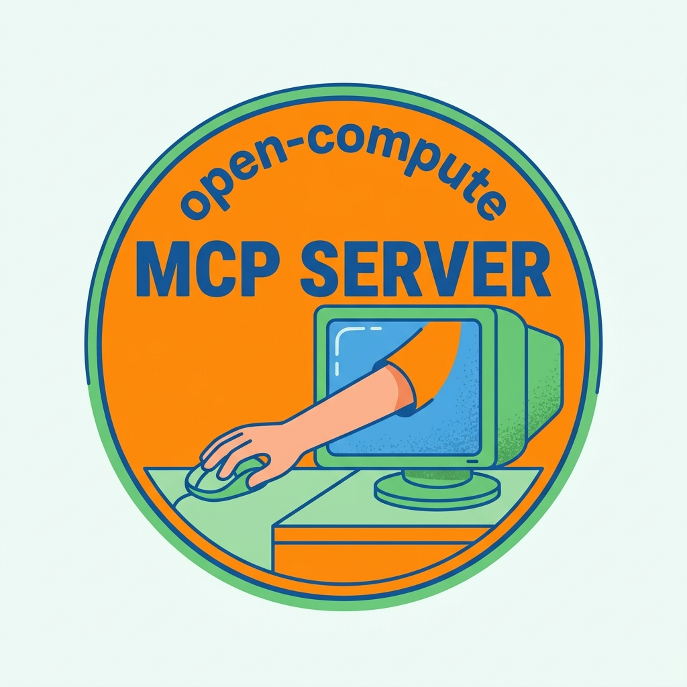
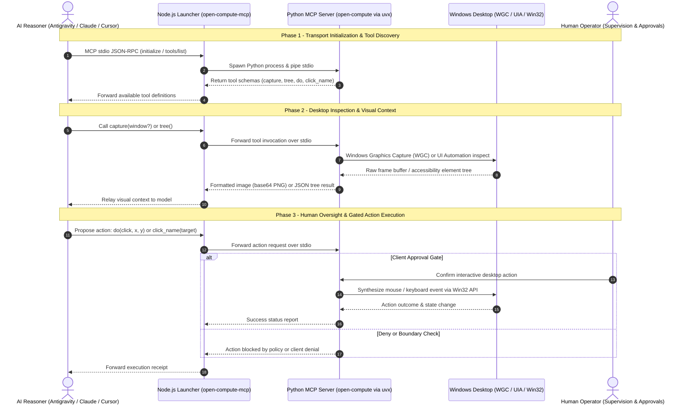

<p align="center">
  
</p>

# open-compute-mcp

> npm launcher for the Python [open-compute MCP server](https://github.com/ellmos-ai/open-compute). It forwards MCP JSON-RPC over local stdin/stdout. Real screen capture and input require an interactive Windows desktop on the MCP client's host. No Glama or other hosted/cloud desktop deployment is provided.

This short entrypoint replaces the long-form [README.md at predecessor commit 59cd953](https://github.com/ellmos-ai/open-compute-mcp/blob/59cd9530688b02c38b75d1926d5a1efdd1a4aa06/README.md). The corrected detailed guide is [archived here](docs/archive/README-2026-10-12.md), retaining the former section anchors and diagrams. It is a corrected copy, not an unchanged historical snapshot; the original remains available at the commit link.

[](https://github.com/ellmos-ai/open-compute-mcp/actions/workflows/ci.yml) [](https://www.npmjs.com/package/open-compute-mcp) [](test/) [](https://nodejs.org/) [](LICENSE) [](https://modelcontextprotocol.io) [](CHANGELOG.md) [](llms.txt)

**EN** | [Deutsch](README_de.md) | [Español](README_es.md)

## Install and run

Requires Node.js 18 or newer and `uv`. The backend requires Python 3.10 or newer; `uvx` can use a compatible installed interpreter or download and manage one when needed. The default launch fetches the Python server from GitHub at the `master` branch; set `OPEN_COMPUTE_GIT_REF` to choose a branch, tag, or commit. These bootstrap steps require network access.

Add this server to a local MCP client:

```json
{
  "mcpServers": {
    "open-compute": {
      "command": "npx",
      "args": ["-y", "open-compute-mcp"]
    }
  }
}
```

The npm package is published separately from this Git repository; check its published version for a particular source revision. A direct `uvx` configuration is in the [detailed quick start](docs/archive/README-2026-10-12.md#sec-03).

## Architecture & Protocol Flow

The launcher bridges client JSON-RPC requests across local stdio to the Python engine executing on the interactive Windows desktop:



## What the launcher does

It starts the Python MCP server and forwards stdio. The wrapper does not implement a network filter, sandbox, privilege drop, or environment scrubber. The child inherits the launcher's environment and operating-system privileges.

The default `uvx` command retrieves the Python project from GitHub; npm installation contacts npm. In an interactive terminal, the optional update notice may check npm. Local stdio describes the client-to-wrapper transport; it does not block network access by the child or MCP client. The client controls routing of tool results, including screenshots.

For real capture and input, run the MCP client on the Windows desktop to be controlled. Action modes and targeting belong to the Python server; configure the client's approval controls. This wrapper is not an operating-system security boundary.

## Tools and configuration

The [tool reference](docs/archive/README-2026-10-12.md#sec-04) is a snapshot of the separate Python project's tool list at a documented source ref. The running server's schemas define the available tools for the selected ref. See also the [environment variables](docs/archive/README-2026-10-12.md#sec-05).

## Related integration

The [Cowork Protocol Desktop Companion](https://github.com/ellmos-ai/cowork-protocol/blob/main/apps/desktop-companion/README.md) includes an optional, human-started computer-use adapter that launches the separate Python Open Compute MCP server over local stdio. Its documented default uses `uvx`; this npm launcher is not a Cowork dependency. This relationship does not change the process, network, or privilege boundaries described above.

## Documentation

- [Architecture and behavior scope](docs/archive/README-2026-10-12.md#sec-01)
- [Security and network scope](docs/archive/README-2026-10-12.md#sec-12)
- [Selected dependency inventory](THIRD_PARTY_LICENSES.md)
- [Security reporting policy](SECURITY.md)
- [Contributing](CONTRIBUTING.md)
- [Changelog](CHANGELOG.md)

The repository source manifest currently declares `0.1.0-alpha.20`. This documentation work changes no version and publishes no release.
