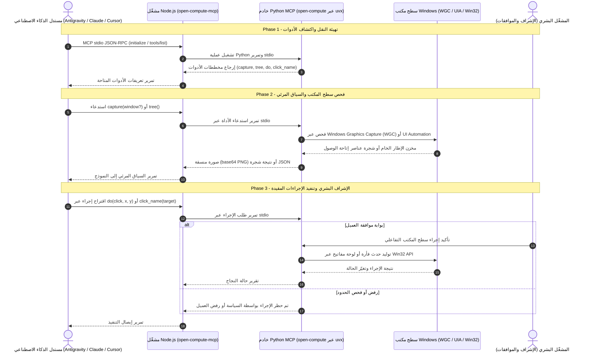

<p align="center">
  
</p>

# open-compute-mcp

> مشغّل npm لخادم Python الخاص بـ [open-compute MCP](https://github.com/ellmos-ai/open-compute). يقوم بتمرير رسائل MCP JSON-RPC عبر stdin/stdout المحلي. يتطلب التقاط الشاشة الفعلي وتنفيذ الإدخالات سطح مكتب Windows تفاعليًا على مضيف عميل MCP. لا يتوفر أي نشر مستضاف عبر Glama أو أي بيئة سطح مكتب سحابية أخرى.

تحل نقطة الدخول الموجزة هذه محل [ملف README.md المطوّل في الإيداع السابق 59cd953](https://github.com/ellmos-ai/open-compute-mcp/blob/59cd9530688b02c38b75d1926d5a1efdd1a4aa06/README.md). يتوفر الدليل المفصّل المصحّح [مؤرشفًا هنا](docs/archive/README-2026-10-12.md)، مع الاحتفاظ بمراسي الأقسام والرسوم التوضيحية السابقة. هذه نسخة مصحّحة وليست لقطة تاريخية غير معدّلة، كما يظل الأصل متاحًا عبر رابط الإيداع.

[](https://github.com/ellmos-ai/open-compute-mcp/actions/workflows/ci.yml) [](https://www.npmjs.com/package/open-compute-mcp) [](test/) [](https://nodejs.org/) [](LICENSE) [](https://modelcontextprotocol.io) [](CHANGELOG.md) [](llms.txt) [](SKILL.md)

[English](README.md) | [Deutsch](README_de.md) | [Español](README_es.md) | [Français](README_fr.md) | [Português](README_pt.md) | [Русский](README_ru.md) | [简体中文](README_zh.md) | [日本語](README_ja.md) | **العربية** | [हिन्दी](README_hi.md) | [বাংলা](README_bn.md)

## التثبيت والتشغيل

يتطلب Node.js 18 أو أحدث و`uv`. يتطلب الخادم الخلفي Python 3.10 أو أحدث، ويمكن لـ `uvx` استخدام مفسّر مثبّت متوافق أو تنزيل نسخة مناسبة وإدارتها عند الحاجة. يجلب التشغيل الافتراضي خادم Python من GitHub على الفرع `master`، ويمكن ضبط `OPEN_COMPUTE_GIT_REF` لاختيار فرع أو وسم أو إيداع محدد. تتطلب خطوات التهيئة الأولية هذه اتصالًا بالشبكة.

أضف هذا الخادم إلى عميل MCP محلي:

```json
{
  "mcpServers": {
    "open-compute": {
      "command": "npx",
      "args": ["-y", "open-compute-mcp"]
    }
  }
}
```

تُنشر حزمة npm بشكل منفصل عن مستودع Git هذا، لذا تحقّق من إصدارها المنشور عند استهداف مراجعة مصدرية بعينها. تتوفر تهيئة `uvx` المباشرة في [دليل البدء السريع المفصّل](docs/archive/README-2026-10-12.md#sec-03).

## البنية وتدفق البروتوكول

يعمل المشغّل كجسر ينقل طلبات JSON-RPC من العميل عبر stdio المحلي إلى محرك Python الذي يعمل على سطح مكتب Windows التفاعلي:



## ما يفعله المشغّل

يقوم بتشغيل خادم Python MCP وتمرير stdio. لا يطبّق هذا الغلاف مرشّح شبكة، ولا وضع عزل (sandbox)، ولا خفض صلاحيات، ولا تنقية لمتغيرات البيئة. ترث العملية الفرعية بيئة المشغّل وصلاحيات نظام التشغيل الخاصة به.

يجلب أمر `uvx` الافتراضي مشروع Python من GitHub، بينما يتصل التثبيت عبر npm بسجل npm. وفي الطرفية التفاعلية، قد يتحقق إشعار التحديث الاختياري من npm. يصف stdio المحلي وسيلة النقل بين العميل والغلاف فقط، ولا يمنع وصول العملية الفرعية أو عميل MCP إلى الشبكة. ويتحكم العميل في توجيه نتائج الأدوات، بما في ذلك لقطات الشاشة.

لالتقاط الشاشة الفعلي وتنفيذ الإدخالات، شغّل عميل MCP على سطح مكتب Windows المراد التحكم به. تنتمي أوضاع الإجراءات وتحديد الأهداف إلى خادم Python، لذا اضبط ضوابط الموافقة في العميل. هذا الغلاف ليس حدًا أمنيًا على مستوى نظام التشغيل.

## الأدوات والتهيئة

يمثّل [مرجع الأدوات](docs/archive/README-2026-10-12.md#sec-04) لقطة لقائمة أدوات مشروع Python المنفصل عند مرجع مصدري موثّق. وتحدّد مخططات الخادم قيد التشغيل الأدوات المتاحة للمرجع المختار. راجع أيضًا [متغيرات البيئة](docs/archive/README-2026-10-12.md#sec-05).

## التكامل ذو الصلة

يتضمّن [Cowork Protocol Desktop Companion](https://github.com/ellmos-ai/cowork-protocol/blob/main/apps/desktop-companion/README.md) محوّل استخدام حاسوب اختياريًا يشغّله الإنسان ويطلق خادم Python Open Compute MCP المنفصل عبر stdio المحلي. يستخدم إعداده الافتراضي الموثّق أداة `uvx`، ولا يُعد مشغّل npm هذا اعتمادية لـ Cowork. ولا تغيّر هذه العلاقة حدود العمليات أو الشبكة أو الصلاحيات الموضحة أعلاه.

## التوثيق

- [البنية ونطاق السلوك](docs/archive/README-2026-10-12.md#sec-01)
- [نطاق الأمان والشبكة](docs/archive/README-2026-10-12.md#sec-12)
- [جرد الاعتماديات المختار](THIRD_PARTY_LICENSES.md)
- [سياسة الإبلاغ عن الثغرات الأمنية](SECURITY.md)
- [المساهمة](CONTRIBUTING.md)
- [سجل التغييرات](CHANGELOG.md)

يصرّح بيان المصدر في المستودع حاليًا بالإصدار `0.1.0-alpha.20`. لا يغيّر هذا التحديث التوثيقي أي إصدار ولا ينشر أي إطلاق جديد.
