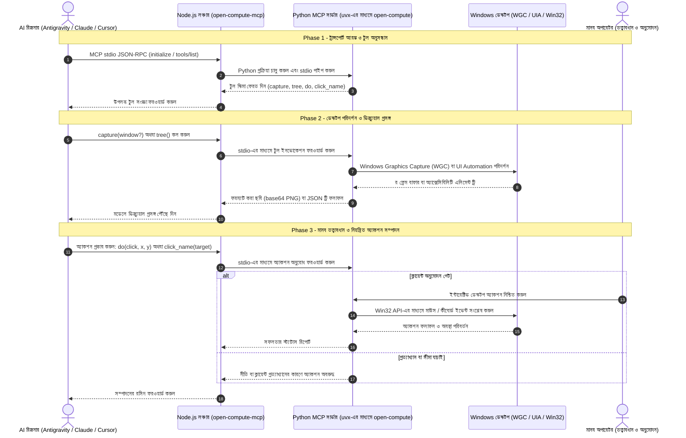

<p align="center">
  
</p>

# open-compute-mcp

> Python [open-compute MCP সার্ভার](https://github.com/ellmos-ai/open-compute)-এর জন্য npm লঞ্চার। এটি স্থানীয় stdin/stdout-এর মাধ্যমে MCP JSON-RPC ফরওয়ার্ড করে। প্রকৃত স্ক্রিন ক্যাপচার এবং ইনপুটের জন্য MCP ক্লায়েন্টের হোস্টে একটি ইন্টারেক্টিভ Windows ডেস্কটপ থাকা প্রয়োজন। কোনো Glama বা অন্যান্য হোস্টেড/ক্লাউড ডেস্কটপ ডিপ্লয়মেন্ট প্রদান করা হয় না।

এই সংক্ষিপ্ত এন্ট্রিপয়েন্টটি [পূর্ববর্তী কমিট 59cd953-এর বিস্তারিত README.md](https://github.com/ellmos-ai/open-compute-mcp/blob/59cd9530688b02c38b75d1926d5a1efdd1a4aa06/README.md)-কে প্রতিস্থাপন করে। সংশোধিত বিস্তারিত নির্দেশিকা [এখানে আর্কাইভ করা আছে](docs/archive/README-2026-10-12.md), যেখানে পূর্বের সেকশন অ্যাঙ্কর ও ডায়াগ্রামগুলো সংরক্ষিত রয়েছে। এটি একটি সংশোধিত অনুলিপি, অপরিবর্তিত ঐতিহাসিক স্ন্যাপশট নয়—মূল সংস্করণটি কমিট লিংকে উপলব্ধ রয়েছে।

[](https://github.com/ellmos-ai/open-compute-mcp/actions/workflows/ci.yml) [](https://www.npmjs.com/package/open-compute-mcp) [](test/) [](https://nodejs.org/) [](LICENSE) [](https://modelcontextprotocol.io) [](CHANGELOG.md) [](llms.txt)

[English](README.md) | [Deutsch](README_de.md) | [Español](README_es.md) | [Français](README_fr.md) | [Português](README_pt.md) | [Русский](README_ru.md) | [简体中文](README_zh.md) | [日本語](README_ja.md) | [العربية](README_ar.md) | [हिन्दी](README_hi.md) | **বাংলা**

## ইনস্টল এবং পরিচালনা

Node.js 18 বা তার পরবর্তী সংস্করণ এবং `uv` প্রয়োজন। ব্যাকএন্ডের জন্য Python 3.10 বা তার পরবর্তী সংস্করণ প্রয়োজন—`uvx` ইনস্টল করা সামঞ্জস্যপূর্ণ ইন্টারপ্রেটার ব্যবহার করতে পারে অথবা প্রয়োজনে একটি ডাউনলোড ও পরিচালনা করতে পারে। ডিফল্ট লঞ্চ GitHub-এর `master` ব্রাঞ্চ থেকে Python সার্ভার সংগ্রহ করে—কোনো ব্রাঞ্চ, ট্যাগ বা কমিট নির্বাচন করতে `OPEN_COMPUTE_GIT_REF` সেট করুন। এই বুটস্ট্র্যাপ ধাপগুলোর জন্য নেটওয়ার্ক অ্যাক্সেস প্রয়োজন।

একটি স্থানীয় MCP ক্লায়েন্টে এই সার্ভারটি যোগ করুন:

```json
{
  "mcpServers": {
    "open-compute": {
      "command": "npx",
      "args": ["-y", "open-compute-mcp"]
    }
  }
}
```

npm প্যাকেজটি এই Git রিপোজিটরি থেকে আলাদাভাবে প্রকাশিত হয়—নির্দিষ্ট কোনো সোর্স রিভিশনের জন্য এর প্রকাশিত সংস্করণ পরীক্ষা করুন। সরাসরি `uvx` কনফিগারেশন [বিস্তারিত দ্রুত শুরু](docs/archive/README-2026-10-12.md#sec-03) অংশে দেওয়া আছে।

## আর্কিটেকচার এবং প্রোটোকল প্রবাহ

লঞ্চারটি স্থানীয় stdio-এর মাধ্যমে ক্লায়েন্টের JSON-RPC অনুরোধগুলো ইন্টারেক্টিভ Windows ডেস্কটপে চলমান Python ইঞ্জিনে পৌঁছে দেয়:



## লঞ্চার কী করে

এটি Python MCP সার্ভার চালু করে এবং stdio ফরওয়ার্ড করে। এই র‍্যাপার কোনো নেটওয়ার্ক ফিল্টার, স্যান্ডবক্স, প্রিভিলেজ ড্রপ বা এনভায়রনমেন্ট স্ক্রাবার প্রয়োগ করে না। চাইল্ড প্রক্রিয়াটি লঞ্চারের এনভায়রনমেন্ট এবং অপারেটিং-সিস্টেমের অধিকার উত্তরাধিকারসূত্রে লাভ করে।

ডিফল্ট `uvx` কমান্ডটি GitHub থেকে Python প্রকল্প সংগ্রহ করে এবং npm ইনস্টলেশন npm-এর সাথে যোগাযোগ করে। ইন্টারেক্টিভ টার্মিনালে ঐচ্ছিক আপডেট বিজ্ঞপ্তি npm পরীক্ষা করতে পারে। স্থানীয় stdio কেবল ক্লায়েন্ট থেকে র‍্যাপার পর্যন্ত ট্রান্সপোর্ট নির্দেশ করে—এটি চাইল্ড প্রক্রিয়া বা MCP ক্লায়েন্টের নেটওয়ার্ক অ্যাক্সেস বন্ধ করে না। স্ক্রিনশটসহ টুল ফলাফলের রাউটিং ক্লায়েন্ট নিয়ন্ত্রণ করে।

প্রকৃত ক্যাপচার এবং ইনপুটের জন্য, নিয়ন্ত্রণযোগ্য Windows ডেস্কটপে MCP ক্লায়েন্ট পরিচালনা করুন। অ্যাকশন মোড এবং টার্গেটিং Python সার্ভারের অন্তর্ভুক্ত—ক্লায়েন্টের অনুমোদন নিয়ন্ত্রণ কনফিগার করুন। এই র‍্যাপারটি কোনো অপারেটিং-সিস্টেম নিরাপত্তা সীমা নয়।

## টুল এবং কনফিগারেশন

[টুল রেফারেন্স](docs/archive/README-2026-10-12.md#sec-04) হলো একটি নথিভুক্ত সোর্স রেফারেন্সে পৃথক Python প্রকল্পের টুল তালিকার একটি স্ন্যাপশট। চলমান সার্ভারের স্কিমাগুলো নির্বাচিত রেফারেন্সের জন্য উপলব্ধ টুলগুলো নির্ধারণ করে। [এনভায়রনমেন্ট ভেরিয়েবল](docs/archive/README-2026-10-12.md#sec-05) অংশটিও দেখুন।

## সম্পর্কিত ইন্টিগ্রেশন

[Cowork Protocol Desktop Companion](https://github.com/ellmos-ai/cowork-protocol/blob/main/apps/desktop-companion/README.md)-এ একটি ঐচ্ছিক, মানব-সূচিত কম্পিউটার-ইউজ অ্যাডাপ্টার অন্তর্ভুক্ত রয়েছে যা স্থানীয় stdio-এর মাধ্যমে পৃথক Python Open Compute MCP সার্ভার চালু করে। এর নথিভুক্ত ডিফল্ট `uvx` ব্যবহার করে—এই npm লঞ্চারটি Cowork-এর কোনো ডিপেন্ডেন্সি নয়। এই সম্পর্ক উপরে বর্ণিত প্রক্রিয়া, নেটওয়ার্ক বা অধিকারের সীমা পরিবর্তন করে না।

## ডকুমেন্টেশন

- [আর্কিটেকচার ও আচরণের পরিসর](docs/archive/README-2026-10-12.md#sec-01)
- [নিরাপত্তা ও নেটওয়ার্ক পরিসর](docs/archive/README-2026-10-12.md#sec-12)
- [নির্বাচিত ডিপেন্ডেন্সি তালিকা](THIRD_PARTY_LICENSES.md)
- [নিরাপত্তা প্রতিবেদন নীতি](SECURITY.md)
- [অবদান](CONTRIBUTING.md)
- [পরিবর্তন তালিকা](CHANGELOG.md)

রিপোজিটরির সোর্স ম্যানিফেস্ট বর্তমানে `0.1.0-alpha.20` ঘোষণা করে। এই ডকুমেন্টেশন কাজটি কোনো সংস্করণ পরিবর্তন করে না এবং কোনো রিলিজ প্রকাশ করে না।
