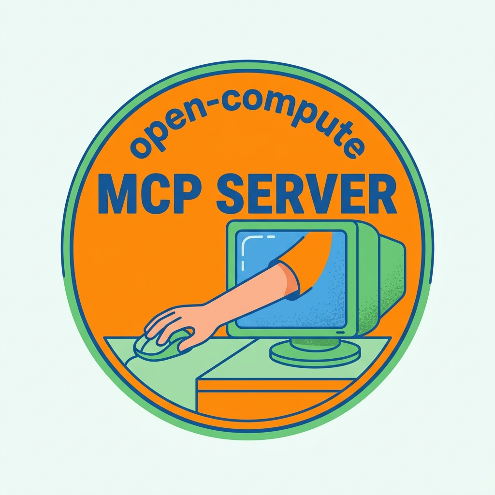
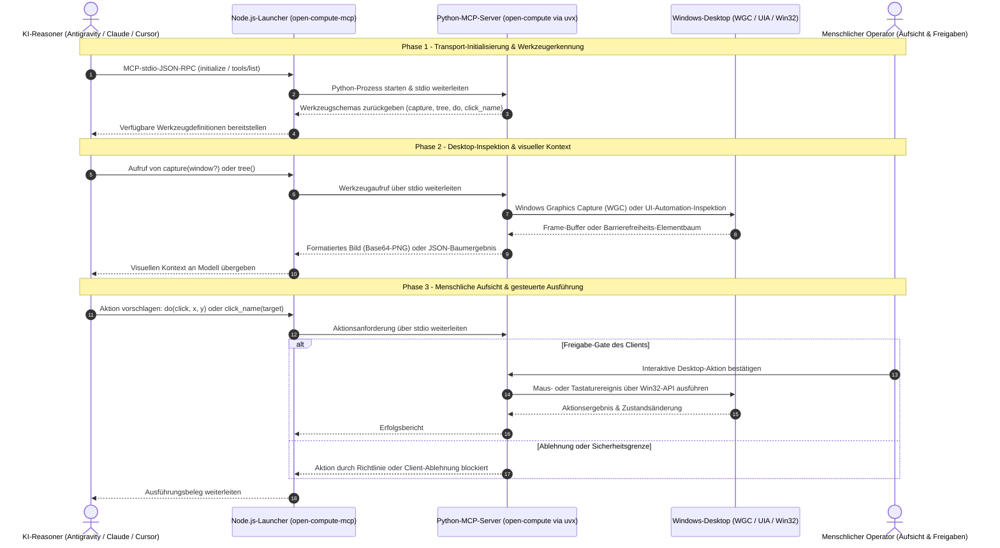

<p align="center">
  
</p>

# open-compute-mcp

> npm-Launcher für den Python-[open-compute-MCP-Server](https://github.com/ellmos-ai/open-compute). Er leitet MCP-JSON-RPC über lokales stdin/stdout weiter. Für echte Bildschirmaufnahme und Eingaben ist ein interaktiver Windows-Desktop auf dem Host des MCP-Clients erforderlich. Eine gehostete Glama- oder andere Cloud-Desktop-Ausführung wird nicht angeboten.

Dieser kurze Einstieg ersetzt die ausführliche [README.md aus dem Vorgänger-Commit 59cd953](https://github.com/ellmos-ai/open-compute-mcp/blob/59cd9530688b02c38b75d1926d5a1efdd1a4aa06/README.md). Der korrigierte Leitfaden im [Archiv](docs/archive/README_de-2026-10-12.md) erhält die früheren Abschnittsanker und Diagramme. Er ist eine korrigierte Fassung, keine unveränderte historische Kopie; das Original bleibt über den Commit-Link erreichbar.

[](https://github.com/ellmos-ai/open-compute-mcp/actions/workflows/ci.yml) [](https://www.npmjs.com/package/open-compute-mcp) [](test/) [](https://nodejs.org/) [](LICENSE) [](https://modelcontextprotocol.io) [](CHANGELOG.md) [](llms.txt)

[English](README.md) | **DE**

## Installieren und starten

Benötigt Node.js 18 oder neuer und `uv`. Das Backend benötigt Python 3.10 oder neuer; `uvx` kann einen passenden installierten Interpreter verwenden oder bei Bedarf selbst einen herunterladen und verwalten. Der Standardstart ruft den Python-Server vom Branch `master` auf GitHub ab. Mit `OPEN_COMPUTE_GIT_REF` lässt sich ein Branch, Tag oder Commit wählen. Diese Einrichtungsschritte benötigen Netzwerkzugriff.

Füge den Server einem lokalen MCP-Client hinzu:

```json
{
  "mcpServers": {
    "open-compute": {
      "command": "npx",
      "args": ["-y", "open-compute-mcp"]
    }
  }
}
```

Das npm-Paket wird getrennt von diesem Git-Repository veröffentlicht. Prüfe seine veröffentlichte Version, wenn du eine bestimmte Quellrevision benötigst. Eine direkte `uvx`-Konfiguration steht im [ausführlichen Schnellstart](docs/archive/README_de-2026-10-12.md#sec-03).

## Architektur & Protokollablauf

Der Launcher vermittelt JSON-RPC-Anfragen des Clients über lokales stdio an die Python-Engine auf dem interaktiven Windows-Desktop:



## Was der Launcher macht

Er startet den Python-MCP-Server und leitet stdio weiter. Der Wrapper implementiert weder Netzwerkfilter noch Sandbox, Rechteabbau oder Bereinigung der Umgebung. Der gestartete Prozess erbt Umgebung und Betriebssystemrechte des Launchers.

Der Standardbefehl `uvx` ruft das Python-Projekt von GitHub ab; die npm-Installation kontaktiert npm. In einem interaktiven Terminal kann der optionale Update-Hinweis npm abfragen. Lokales stdio beschreibt nur den Transport zwischen Client und Wrapper; es sperrt weder den Netzzugriff des gestarteten Prozesses noch den des MCP-Clients. Der Client entscheidet, wie er Werkzeugergebnisse einschließlich Screenshots weiterleitet.

Für echte Bildschirmaufnahme und Eingaben muss der MCP-Client auf dem zu steuernden Windows-Desktop laufen. Aktionsmodi und Zielauswahl gehören zum Python-Server; konfiguriere die Freigaben des Clients. Der Wrapper ist keine Sicherheitsgrenze des Betriebssystems.

## Werkzeuge und Konfiguration

Die [Werkzeugübersicht](docs/archive/README_de-2026-10-12.md#sec-04) ist ein Snapshot der Werkzeugliste des separaten Python-Projekts zu einem dokumentierten Quell-Ref. Die Schemas des gestarteten Servers bestimmen die verfügbaren Werkzeuge des gewählten Refs. Siehe auch die [Umgebungsvariablen](docs/archive/README_de-2026-10-12.md#sec-05).

## Verwandte Integration

Der [Desktop Companion von Cowork Protocol](https://github.com/ellmos-ai/cowork-protocol/blob/main/apps/desktop-companion/README.md) bietet einen optionalen, vom Menschen gestarteten Computer-Use-Pfad über den separaten Python-Open-Compute-MCP-Server mit lokalem stdio. Die dokumentierte Standardkonfiguration startet das Python-Projekt über `uvx`; dieser npm-Launcher ist keine Cowork-Abhängigkeit. Der Querverweis ändert die oben beschriebenen Prozess-, Netzwerk- oder Berechtigungsgrenzen des Launchers nicht.

## Dokumentation

- [Architektur und Verhaltensgrenzen](docs/archive/README_de-2026-10-12.md#sec-01)
- [Sicherheits- und Netzwerkumfang](docs/archive/README_de-2026-10-12.md#sec-12)
- [Ausgewähltes Abhängigkeitsinventar](THIRD_PARTY_LICENSES.md)
- [Richtlinie für Sicherheitsmeldungen](SECURITY.md)
- [Mitwirken](CONTRIBUTING.md)
- [Änderungsprotokoll](CHANGELOG.md)

Das Quellmanifest dieses Repositorys nennt derzeit `0.1.0-alpha.20`. Diese Dokumentationspflege ändert keine Version und veröffentlicht kein Release.
