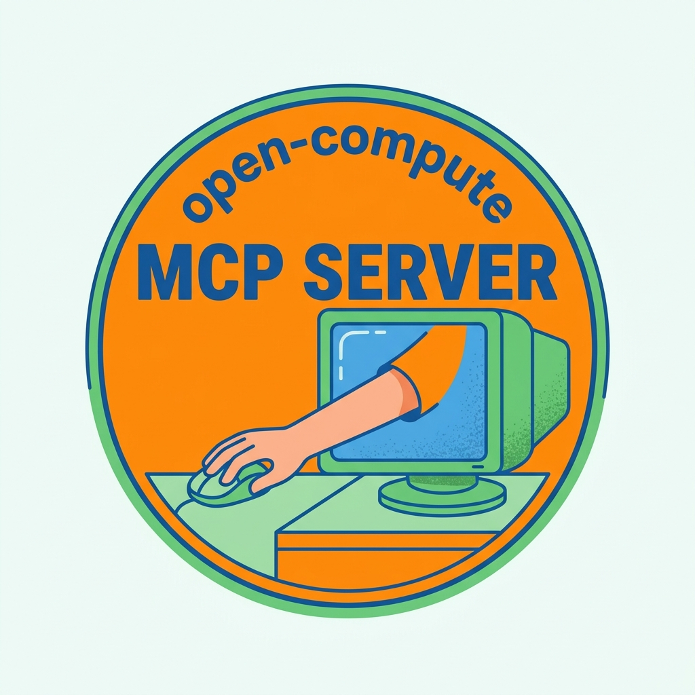
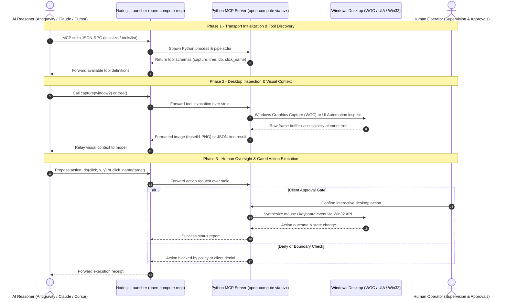

<p align="center">
  
</p>

# open-compute-mcp

> Lanzador npm para el servidor MCP de Python [open-compute](https://github.com/ellmos-ai/open-compute). Reenvía MCP JSON-RPC por stdin/stdout local. La captura real de pantalla y la entrada requieren un escritorio interactivo de Windows en el host del cliente MCP. No se ofrece un despliegue de escritorio alojado en Glama ni en la nube.

Esta página de inicio breve sustituye a la guía extensa [README.md del commit predecesor 59cd953](https://github.com/ellmos-ai/open-compute-mcp/blob/59cd9530688b02c38b75d1926d5a1efdd1a4aa06/README.md). La guía detallada corregida está [archivada aquí](docs/archive/README-2026-10-12.md), donde conserva los antiguos anclajes de sección y diagramas. Es una copia corregida, no una instantánea histórica sin cambios; el original sigue disponible mediante el enlace al commit.

[](https://github.com/ellmos-ai/open-compute-mcp/actions/workflows/ci.yml) [](https://www.npmjs.com/package/open-compute-mcp) [](test/) [](https://nodejs.org/) [](LICENSE) [](https://modelcontextprotocol.io) [](CHANGELOG.md) [](llms.txt)

[English](README.md) | [Deutsch](README_de.md) | **Español**

## Instalar y ejecutar

Requiere Node.js 18 o posterior y `uv`. El backend requiere Python 3.10 o posterior; `uvx` puede usar un intérprete compatible ya instalado o descargarlo y gestionarlo cuando sea necesario. El inicio predeterminado obtiene el servidor Python de GitHub en la rama `master`; configura `OPEN_COMPUTE_GIT_REF` para elegir una rama, etiqueta o commit. Estos pasos de inicialización requieren acceso a la red.

Añade este servidor a un cliente MCP local:

```json
{
  "mcpServers": {
    "open-compute": {
      "command": "npx",
      "args": ["-y", "open-compute-mcp"]
    }
  }
}
```

El paquete npm se publica por separado de este repositorio Git; consulta la versión publicada si necesitas una revisión concreta del código fuente. Hay una configuración directa con `uvx` en la [guía de inicio rápido detallada](docs/archive/README-2026-10-12.md#sec-03).

## Arquitectura y flujo del protocolo

El lanzador conecta las solicitudes JSON-RPC del cliente, mediante stdio local, con el motor Python que se ejecuta en el escritorio interactivo de Windows:



## Qué hace el lanzador

Inicia el servidor MCP de Python y reenvía stdio. El wrapper no implementa un filtro de red, una sandbox, una reducción de privilegios ni un mecanismo de limpieza del entorno. El proceso hijo hereda el entorno y los privilegios del sistema operativo del lanzador.

El comando predeterminado `uvx` obtiene el proyecto Python de GitHub; la instalación de npm se conecta a npm. En un terminal interactivo, el aviso opcional de actualización puede consultar npm. El stdio local describe el transporte entre el cliente y el wrapper; no bloquea el acceso a la red del proceso hijo ni el del cliente MCP. El cliente controla el enrutamiento de los resultados de las herramientas, incluidas las capturas de pantalla.

Para disponer de captura real y entrada, ejecuta el cliente MCP en el escritorio de Windows que quieras controlar. Los modos de acción y la selección de objetivos pertenecen al servidor Python; configura los controles de aprobación del cliente. Este wrapper no constituye una frontera de seguridad del sistema operativo.

## Herramientas y configuración

La [referencia de herramientas](docs/archive/README-2026-10-12.md#sec-04) es una instantánea de la lista de herramientas del proyecto Python independiente en una revisión de origen documentada. Los esquemas del servidor en ejecución determinan las herramientas disponibles para la revisión elegida. Consulta también las [variables de entorno](docs/archive/README-2026-10-12.md#sec-05).

## Integración relacionada

El [Cowork Protocol Desktop Companion](https://github.com/ellmos-ai/cowork-protocol/blob/main/apps/desktop-companion/README.md) incluye un adaptador opcional de uso del ordenador que inicia una persona y ejecuta el servidor MCP de Python Open Compute independiente mediante stdio local. La configuración predeterminada documentada usa `uvx`; este lanzador npm no es una dependencia de Cowork. Esta relación no modifica los límites de proceso, red o privilegios descritos anteriormente.

## Documentación

- [Alcance de la arquitectura y del comportamiento](docs/archive/README-2026-10-12.md#sec-01)
- [Alcance de seguridad y red](docs/archive/README-2026-10-12.md#sec-12)
- [Inventario seleccionado de dependencias](THIRD_PARTY_LICENSES.md)
- [Política de comunicación de vulnerabilidades](SECURITY.md)
- [Contribución](CONTRIBUTING.md)
- [Registro de cambios](CHANGELOG.md)

El manifiesto de origen del repositorio declara actualmente `0.1.0-alpha.20`. Este trabajo de documentación no cambia ninguna versión ni publica una versión nueva.
