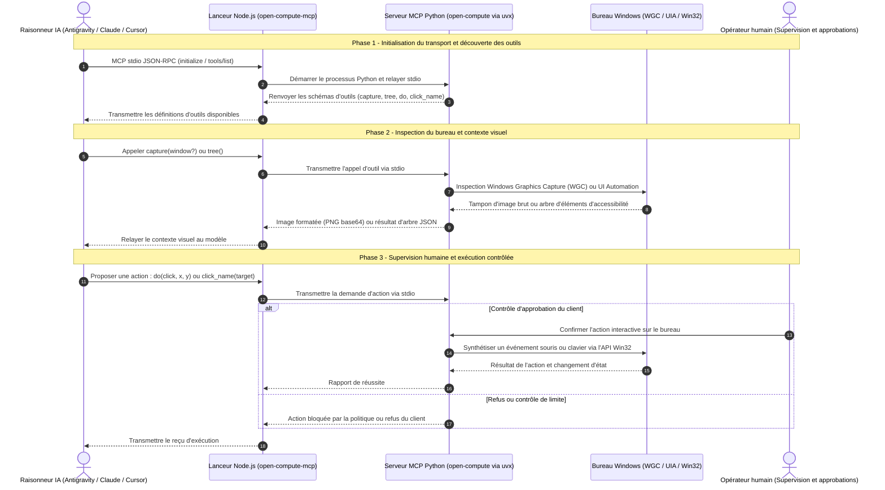

<p align="center">
  
</p>

# open-compute-mcp

> Lanceur npm pour le [serveur MCP open-compute](https://github.com/ellmos-ai/open-compute) en Python. Il relaie les appels MCP JSON-RPC via stdin/stdout locaux. La capture d'écran réelle et les entrées utilisateur nécessitent un bureau Windows interactif sur l'hôte du client MCP. Aucun déploiement hébergé (Glama ou autre bureau cloud) n'est fourni.

Ce court point d'entrée remplace le fichier détaillé [README.md du commit prédécesseur 59cd953](https://github.com/ellmos-ai/open-compute-mcp/blob/59cd9530688b02c38b75d1926d5a1efdd1a4aa06/README.md). Le guide détaillé corrigé est [archivé ici](docs/archive/README-2026-10-12.md) et conserve les ancres de section et diagrammes précédents. Il s'agit d'une copie corrigée, et non d'un instantané historique inchangé ; l'original reste accessible via le lien du commit.

[](https://github.com/ellmos-ai/open-compute-mcp/actions/workflows/ci.yml) [](https://www.npmjs.com/package/open-compute-mcp) [](test/) [](https://nodejs.org/) [](LICENSE) [](https://modelcontextprotocol.io) [](CHANGELOG.md) [](llms.txt) [](SKILL.md)

[English](README.md) | [Deutsch](README_de.md) | [Español](README_es.md) | **Français** | [Português](README_pt.md) | [Русский](README_ru.md) | [简体中文](README_zh.md) | [日本語](README_ja.md) | [العربية](README_ar.md) | [हिन्दी](README_hi.md) | [বাংলা](README_bn.md)

## Installation et exécution

Nécessite Node.js 18 ou supérieur et `uv`. Le backend requiert Python 3.10 ou supérieur ; `uvx` peut utiliser un interpréteur compatible déjà installé ou en télécharger et gérer un au besoin. Le lancement par défaut récupère le serveur Python depuis GitHub sur la branche `master` ; définissez `OPEN_COMPUTE_GIT_REF` pour choisir une branche, un tag ou un commit. Ces étapes d'amorçage nécessitent un accès réseau.

Ajoutez ce serveur à un client MCP local :

```json
{
  "mcpServers": {
    "open-compute": {
      "command": "npx",
      "args": ["-y", "open-compute-mcp"]
    }
  }
}
```

Le paquet npm est publié séparément de ce dépôt Git ; vérifiez sa version publiée pour une révision source donnée. Une configuration directe avec `uvx` figure dans le [guide de démarrage rapide détaillé](docs/archive/README-2026-10-12.md#sec-03).

## Architecture et flux du protocole

Le lanceur relaie les requêtes JSON-RPC du client via stdio local vers le moteur Python exécuté sur le bureau Windows interactif :



## Ce que fait le lanceur

Il démarre le serveur MCP Python et relaie stdio. Le wrapper n'implémente ni filtre réseau, ni bac à sable (sandbox), ni réduction de privilèges, ni nettoyage des variables d'environnement. Le processus enfant hérite de l'environnement et des privilèges système du lanceur.

La commande `uvx` par défaut récupère le projet Python depuis GitHub ; l'installation npm contacte npm. Dans un terminal interactif, l'avis de mise à jour facultatif peut interroger npm. Le stdio local décrit uniquement le transport entre le client et le wrapper ; il ne bloque l'accès réseau ni du processus enfant ni du client MCP. Le client contrôle l'acheminement des résultats d'outils, captures d'écran comprises.

Pour effectuer de véritables captures et saisies, exécutez le client MCP sur le bureau Windows à contrôler. Les modes d'action et le ciblage relèvent du serveur Python ; configurez les contrôles d'approbation du client. Ce wrapper ne constitue pas une frontière de sécurité du système d'exploitation.

## Outils et configuration

La [référence des outils](docs/archive/README-2026-10-12.md#sec-04) est un instantané de la liste des outils du projet Python distinct à une référence source documentée. Les schémas du serveur en cours d'exécution définissent les outils disponibles pour la référence sélectionnée. Voir aussi les [variables d'environnement](docs/archive/README-2026-10-12.md#sec-05).

## Intégration associée

Le [Cowork Protocol Desktop Companion](https://github.com/ellmos-ai/cowork-protocol/blob/main/apps/desktop-companion/README.md) inclut un adaptateur de contrôle du bureau facultatif, démarré par un humain, qui lance le serveur MCP Python distinct Open Compute via stdio local. Sa configuration par défaut documentée utilise `uvx` ; ce lanceur npm n'est pas une dépendance de Cowork. Cette relation ne modifie en rien les limites de processus, de réseau ou de privilèges décrites ci-dessus.

## Documentation

- [Architecture et portée comportementale](docs/archive/README-2026-10-12.md#sec-01)
- [Portée sécurité et réseau](docs/archive/README-2026-10-12.md#sec-12)
- [Inventaire des dépendances sélectionnées](THIRD_PARTY_LICENSES.md)
- [Politique de signalement de sécurité](SECURITY.md)
- [Contribuer](CONTRIBUTING.md)
- [Journal des modifications](CHANGELOG.md)

Le manifeste source du dépôt déclare actuellement `0.1.0-alpha.20`. Ce travail de documentation ne modifie aucune version et ne publie aucune nouvelle version.
