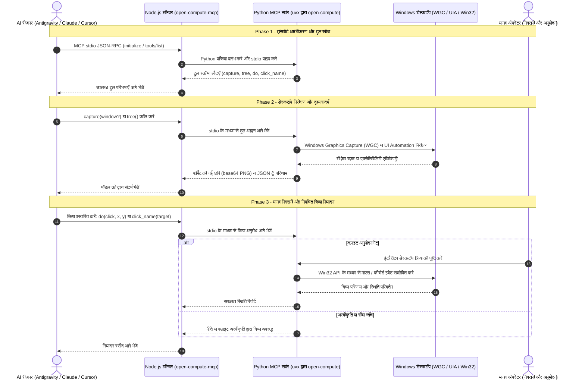

<p align="center">
  
</p>

# open-compute-mcp

> Python आधारित [open-compute MCP सर्वर](https://github.com/ellmos-ai/open-compute) के लिए npm लॉन्चर। यह स्थानीय stdin/stdout के माध्यम से MCP JSON-RPC को आगे भेजता है। वास्तविक स्क्रीन कैप्चर और इनपुट के लिए MCP क्लाइंट के होस्ट पर एक इंटरैक्टिव Windows डेस्कटॉप आवश्यक है। कोई Glama या अन्य होस्टेड/क्लाउड डेस्कटॉप डिप्लॉयमेंट उपलब्ध नहीं है।

यह संक्षिप्त प्रवेश बिंदु [पूर्ववर्ती कमिट 59cd953 के विस्तृत README.md](https://github.com/ellmos-ai/open-compute-mcp/blob/59cd9530688b02c38b75d1926d5a1efdd1a4aa06/README.md) का स्थान लेता है। संशोधित विस्तृत मार्गदर्शिका [यहाँ संग्रहीत](docs/archive/README-2026-10-12.md) है, जिसमें पिछले सेक्शन एंकर और आरेख सुरक्षित रखे गए हैं। यह एक संशोधित प्रति है, अपरिवर्तित ऐतिहासिक स्नैपशॉट नहीं—मूल संस्करण कमिट लिंक पर उपलब्ध रहता है।

[](https://github.com/ellmos-ai/open-compute-mcp/actions/workflows/ci.yml) [](https://www.npmjs.com/package/open-compute-mcp) [](test/) [](https://nodejs.org/) [](LICENSE) [](https://modelcontextprotocol.io) [](CHANGELOG.md) [](SKILL.md) [](llms.txt)

[English](README.md) | [Deutsch](README_de.md) | [Español](README_es.md) | [Français](README_fr.md) | [Português](README_pt.md) | [Русский](README_ru.md) | [简体中文](README_zh.md) | [日本語](README_ja.md) | [العربية](README_ar.md) | **हिन्दी** | [বাংলা](README_bn.md)

## इंस्टॉल करें और चलाएँ

इसके लिए Node.js 18 या नया संस्करण और `uv` आवश्यक है। बैकएंड के लिए Python 3.10 या नया संस्करण आवश्यक है—`uvx` पहले से इंस्टॉल किए गए संगत इंटरप्रेटर का उपयोग कर सकता है या आवश्यकता पड़ने पर स्वयं एक डाउनलोड और प्रबंधित कर सकता है। डिफ़ॉल्ट लॉन्च GitHub की `master` ब्रांच से Python सर्वर प्राप्त करता है—किसी ब्रांच, टैग या कमिट को चुनने के लिए `OPEN_COMPUTE_GIT_REF` सेट करें। इन बूटस्ट्रैप चरणों के लिए नेटवर्क एक्सेस आवश्यक है।

इस सर्वर को एक स्थानीय MCP क्लाइंट में जोड़ें:

```json
{
  "mcpServers": {
    "open-compute": {
      "command": "npx",
      "args": ["-y", "open-compute-mcp"]
    }
  }
}
```

npm पैकेज इस Git रिपॉजिटरी से अलग प्रकाशित किया जाता है—किसी विशेष सोर्स रिवीजन के लिए इसका प्रकाशित संस्करण जाँचें। प्रत्यक्ष `uvx` कॉन्फ़िगरेशन [विस्तृत त्वरित प्रारंभ](docs/archive/README-2026-10-12.md#sec-03) में दिया गया है।

## आर्किटेक्चर और प्रोटोकॉल प्रवाह

लॉन्चर स्थानीय stdio के माध्यम से क्लाइंट के JSON-RPC अनुरोधों को इंटरैक्टिव Windows डेस्कटॉप पर चल रहे Python इंजन तक पहुँचाता है:



## लॉन्चर क्या करता है

यह Python MCP सर्वर को प्रारंभ करता है और stdio को आगे भेजता है। यह रैपर कोई नेटवर्क फ़िल्टर, सैंडबॉक्स, विशेषाधिकार घटाव (privilege drop) या एनवायरनमेंट स्क्रबर लागू नहीं करता है। चाइल्ड प्रक्रिया लॉन्चर के एनवायरनमेंट और ऑपरेटिंग-सिस्टम विशेषाधिकारों को विरासत में प्राप्त करती है।

डिफ़ॉल्ट `uvx` कमांड GitHub से Python प्रोजेक्ट प्राप्त करता है और npm इंस्टॉलेशन npm से संपर्क करता है। इंटरैक्टिव टर्मिनल में वैकल्पिक अपडेट सूचना npm की जाँच कर सकती है। स्थानीय stdio क्लाइंट-से-रैपर ट्रांसपोर्ट का वर्णन करता है—यह चाइल्ड प्रक्रिया या MCP क्लाइंट द्वारा नेटवर्क एक्सेस को अवरुद्ध नहीं करता। स्क्रीनशॉट सहित टूल परिणामों की रूटिंग क्लाइंट नियंत्रित करता है।

वास्तविक कैप्चर और इनपुट के लिए, नियंत्रित किए जाने वाले Windows डेस्कटॉप पर ही MCP क्लाइंट चलाएँ। एक्शन मोड और टारगेटिंग Python सर्वर से संबंधित हैं—क्लाइंट के अनुमोदन नियंत्रण कॉन्फ़िगर करें। यह रैपर कोई ऑपरेटिंग-सिस्टम सुरक्षा सीमा नहीं है।

## टूल्स और कॉन्फ़िगरेशन

[टूल संदर्भ](docs/archive/README-2026-10-12.md#sec-04) किसी प्रलेखित सोर्स संदर्भ पर अलग Python प्रोजेक्ट की टूल सूची का एक स्नैपशॉट है। चल रहे सर्वर के स्कीमा चुने गए संदर्भ के लिए उपलब्ध टूल्स को परिभाषित करते हैं। [एनवायरनमेंट वेरिएबल्स](docs/archive/README-2026-10-12.md#sec-05) भी देखें।

## संबंधित एकीकरण

[Cowork Protocol Desktop Companion](https://github.com/ellmos-ai/cowork-protocol/blob/main/apps/desktop-companion/README.md) में एक वैकल्पिक, मानव-प्रारंभित कंप्यूटर-यूज़ एडाप्टर शामिल है जो स्थानीय stdio पर अलग Python Open Compute MCP सर्वर को लॉन्च करता है। इसका प्रलेखित डिफ़ॉल्ट `uvx` का उपयोग करता है—यह npm लॉन्चर Cowork की निर्भरता नहीं है। यह संबंध ऊपर वर्णित प्रक्रिया, नेटवर्क या विशेषाधिकार सीमाओं को नहीं बदलता है।

## प्रलेखन

- [आर्किटेक्चर और व्यवहार सीमा](docs/archive/README-2026-10-12.md#sec-01)
- [सुरक्षा और नेटवर्क सीमा](docs/archive/README-2026-10-12.md#sec-12)
- [चयनित निर्भरता सूची](THIRD_PARTY_LICENSES.md)
- [सुरक्षा रिपोर्टिंग नीति](SECURITY.md)
- [योगदान](CONTRIBUTING.md)
- [परिवर्तन लॉग](CHANGELOG.md)

रिपॉजिटरी सोर्स मैनिफेस्ट वर्तमान में `0.1.0-alpha.20` घोषित करता है। यह प्रलेखन कार्य कोई संस्करण नहीं बदलता और कोई रिलीज़ प्रकाशित नहीं करता है।
