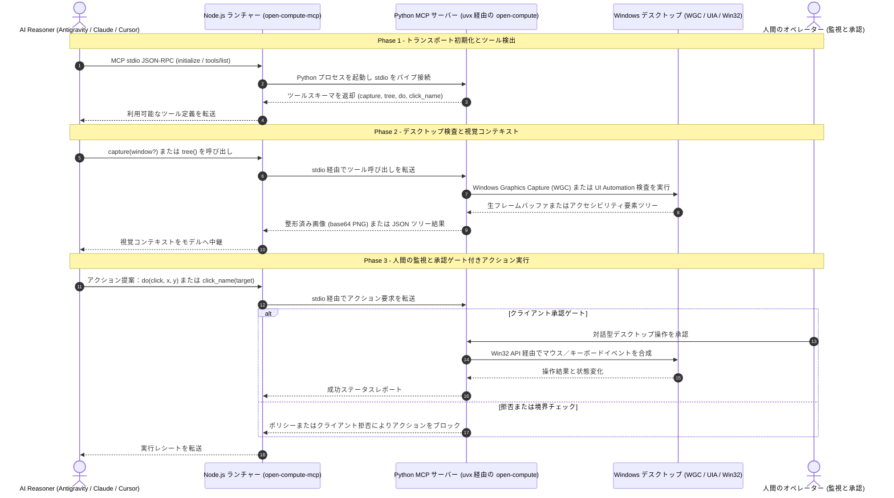

<p align="center">
  
</p>

# open-compute-mcp

> Python 製 [open-compute MCP サーバー](https://github.com/ellmos-ai/open-compute)用の npm ランチャーです。ローカルの stdin/stdout を介して MCP JSON-RPC を中継します。実際の画面キャプチャおよび入力操作には、MCP クライアントのホスト上で対話型 Windows デスクトップが稼働している必要があります。Glama やその他のホスト型／クラウド上のデスクトップ実行環境は提供されていません。

この簡潔なエントリーポイントは、[先行コミット 59cd953 時点の長文 README.md](https://github.com/ellmos-ai/open-compute-mcp/blob/59cd9530688b02c38b75d1926d5a1efdd1a4aa06/README.md) を置き換えるものです。修正済みの詳細ガイドは[こちらにアーカイブ](docs/archive/README-2026-10-12.md)されており、従来のセクションアンカーや図表を保持しています。これは未変更の歴史的スナップショットではなく修正済みの複製であり、原文は上記コミットリンクから引き続き参照できます。

[](https://github.com/ellmos-ai/open-compute-mcp/actions/workflows/ci.yml) [](https://www.npmjs.com/package/open-compute-mcp) [](test/) [](https://nodejs.org/) [](LICENSE) [](https://modelcontextprotocol.io) [](CHANGELOG.md) [](SKILL.md) [](llms.txt)

[English](README.md) | [Deutsch](README_de.md) | [Español](README_es.md) | [Français](README_fr.md) | [Português](README_pt.md) | [Русский](README_ru.md) | [简体中文](README_zh.md) | **日本語** | [العربية](README_ar.md) | [हिन्दी](README_hi.md) | [বাংলা](README_bn.md)

## インストールと実行

Node.js 18 以降および `uv` が必要です。バックエンドには Python 3.10 以降が必要であり、`uvx` はインストール済みの互換インタプリタを使用するか、必要に応じて適切なバージョンをダウンロード・管理します。デフォルトの起動設定では GitHub の `master` ブランチから Python サーバーを取得します。ブランチ、タグ、またはコミットを指定するには `OPEN_COMPUTE_GIT_REF` を設定してください。これらのブートストラップ手順にはネットワークアクセスが必要です。

ローカルの MCP クライアントにこのサーバーを追加します：

```json
{
  "mcpServers": {
    "open-compute": {
      "command": "npx",
      "args": ["-y", "open-compute-mcp"]
    }
  }
}
```

npm パッケージはこの Git リポジトリとは別に公開されています。特定のソースリビジョンに対応する公開バージョンを確認してください。`uvx` を直接使用する設定については、[詳細なクイックスタート](docs/archive/README-2026-10-12.md#sec-03)を参照してください。

## アーキテクチャとプロトコルフロー

ランチャーはローカルの stdio を介してクライアントの JSON-RPC リクエストを中継し、対話型 Windows デスクトップ上で動作する Python エンジンへ橋渡しします：



## ランチャーの動作範囲

Python MCP サーバーを起動し、stdio を転送します。このラッパーはネットワークフィルター、サンドボックス、権限降格、環境変数のサニタイズのいずれも実装していません。子プロセスはランチャーの環境変数と OS 権限をそのまま継承します。

デフォルトの `uvx` コマンドは GitHub から Python プロジェクトを取得し、npm インストールは npm に接続します。対話型ターミナルでは、オプションのアップデート通知が npm を確認する場合があります。ローカル stdio はクライアントとラッパー間のトランスポート方式を指すものであり、子プロセスや MCP クライアントによるネットワークアクセスを遮断するものではありません。スクリーンショットを含むツール結果のルーティングはクライアント側が制御します。

実際の画面キャプチャと入力操作を行うには、制御対象となる Windows デスクトップ上で MCP クライアントを実行してください。アクションモードやターゲット指定は Python サーバー側の機能であり、承認制御はクライアント側で設定します。このラッパーは OS のセキュリティ境界ではありません。

## ツールと設定

[ツールリファレンス](docs/archive/README-2026-10-12.md#sec-04)は、文書化されたソース参照時点における別プロジェクト（Python 版）のツール一覧のスナップショットです。選択したリファレンスで利用可能なツールは、実行中サーバーのスキーマによって定義されます。[環境変数](docs/archive/README-2026-10-12.md#sec-05)もあわせて参照してください。

## 関連インテグレーション

[Cowork Protocol Desktop Companion](https://github.com/ellmos-ai/cowork-protocol/blob/main/apps/desktop-companion/README.md) には、ローカル stdio 経由で別個の Python 製 Open Compute MCP サーバーを起動する、人間が開始するオプションの Computer-Use アダプターが含まれています。文書化されたデフォルト設定では `uvx` を使用しており、この npm ランチャーは Cowork の依存関係ではありません。この関連性によって、上述のプロセス、ネットワーク、または権限の境界が変更されることはありません。

## ドキュメント

- [アーキテクチャと動作範囲](docs/archive/README-2026-10-12.md#sec-01)
- [セキュリティおよびネットワーク範囲](docs/archive/README-2026-10-12.md#sec-12)
- [主要依存関係インベントリ](THIRD_PARTY_LICENSES.md)
- [セキュリティ報告ポリシー](SECURITY.md)
- [コントリビューション](CONTRIBUTING.md)
- [変更履歴](CHANGELOG.md)

リポジトリのソースマニフェストは現在 `0.1.0-alpha.20` を宣言しています。このドキュメント作業によってバージョンが変更されたり、リリースが公開されたりすることはありません。
