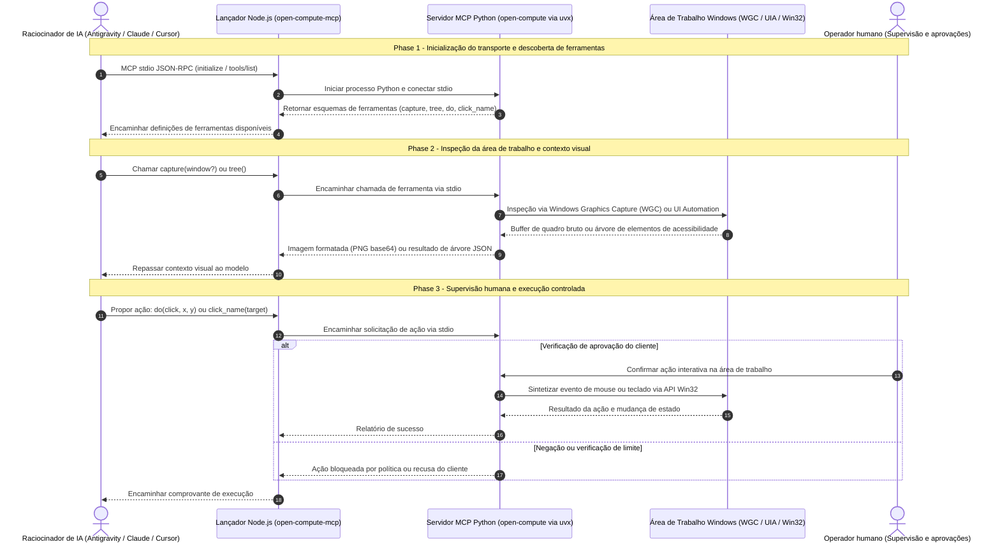

<p align="center">
  
</p>

# open-compute-mcp

> Lançador npm para o [servidor MCP open-compute](https://github.com/ellmos-ai/open-compute) em Python. Ele encaminha MCP JSON-RPC por stdin/stdout locais. A captura de tela real e o envio de entradas exigem uma área de trabalho interativa do Windows no host do cliente MCP. Nenhuma implantação hospedada (Glama ou outra área de trabalho na nuvem) é fornecida.

Este ponto de entrada curto substitui o arquivo longo [README.md no commit predecessor 59cd953](https://github.com/ellmos-ai/open-compute-mcp/blob/59cd9530688b02c38b75d1926d5a1efdd1a4aa06/README.md). O guia detalhado corrigido está [arquivado aqui](docs/archive/README-2026-10-12.md), preservando as âncoras de seção e os diagramas anteriores. Trata-se de uma cópia corrigida, não de um instantâneo histórico inalterado; o original permanece disponível no link do commit.

[](https://github.com/ellmos-ai/open-compute-mcp/actions/workflows/ci.yml) [](https://www.npmjs.com/package/open-compute-mcp) [](test/) [](https://nodejs.org/) [](LICENSE) [](https://modelcontextprotocol.io) [](CHANGELOG.md) [](llms.txt)

[English](README.md) | [Deutsch](README_de.md) | [Español](README_es.md) | [Français](README_fr.md) | **Português** | [Русский](README_ru.md) | [简体中文](README_zh.md) | [日本語](README_ja.md) | [العربية](README_ar.md) | [हिन्दी](README_hi.md) | [বাংলা](README_bn.md)

## Instalar e executar

Requer Node.js 18 ou superior e `uv`. O backend requer Python 3.10 ou superior; o `uvx` pode usar um interpretador compatível instalado ou baixar e gerenciar um quando necessário. A inicialização padrão busca o servidor Python no GitHub na branch `master`; defina `OPEN_COMPUTE_GIT_REF` para escolher uma branch, tag ou commit. Essas etapas iniciais exigem acesso à rede.

Adicione este servidor a um cliente MCP local:

```json
{
  "mcpServers": {
    "open-compute": {
      "command": "npx",
      "args": ["-y", "open-compute-mcp"]
    }
  }
}
```

O pacote npm é publicado separadamente deste repositório Git; verifique a versão publicada correspondente a uma revisão específica do código-fonte. Uma configuração direta com `uvx` está no [guia detalhado de início rápido](docs/archive/README-2026-10-12.md#sec-03).

## Arquitetura e fluxo de protocolo

O lançador intermedeia requisições JSON-RPC do cliente via stdio local para o motor Python em execução na área de trabalho interativa do Windows:



## O que o lançador faz

Ele inicia o servidor MCP Python e encaminha stdio. O wrapper não implementa filtro de rede, sandbox, redução de privilégios nem limpeza de ambiente. O processo filho herda o ambiente e os privilégios de sistema operacional do lançador.

O comando `uvx` padrão obtém o projeto Python do GitHub; a instalação via npm contata o npm. Em um terminal interativo, o aviso opcional de atualização pode consultar o npm. O stdio local descreve o transporte entre o cliente e o wrapper; ele não bloqueia o acesso à rede pelo processo filho nem pelo cliente MCP. O cliente controla o roteamento dos resultados das ferramentas, incluindo capturas de tela.

Para captura e entrada reais, execute o cliente MCP na área de trabalho do Windows a ser controlada. Os modos de ação e o direcionamento pertencem ao servidor Python; configure os controles de aprovação do cliente. Este wrapper não é uma fronteira de segurança do sistema operacional.

## Ferramentas e configuração

A [referência de ferramentas](docs/archive/README-2026-10-12.md#sec-04) é um instantâneo da lista de ferramentas do projeto Python separado em uma referência de código-fonte documentada. Os esquemas do servidor em execução definem as ferramentas disponíveis para a referência selecionada. Veja também as [variáveis de ambiente](docs/archive/README-2026-10-12.md#sec-05).

## Integração relacionada

O [Cowork Protocol Desktop Companion](https://github.com/ellmos-ai/cowork-protocol/blob/main/apps/desktop-companion/README.md) inclui um adaptador opcional de uso de computador iniciado por humanos que executa o servidor MCP Python separado Open Compute via stdio local. Seu padrão documentado utiliza `uvx`; este lançador npm não é uma dependência do Cowork. Essa relação não altera os limites de processo, rede ou privilégios descritos acima.

## Documentação

- [Arquitetura e escopo de comportamento](docs/archive/README-2026-10-12.md#sec-01)
- [Escopo de segurança e rede](docs/archive/README-2026-10-12.md#sec-12)
- [Inventário de dependências selecionadas](THIRD_PARTY_LICENSES.md)
- [Política de relato de segurança](SECURITY.md)
- [Contribuindo](CONTRIBUTING.md)
- [Registro de alterações](CHANGELOG.md)

O manifesto de código-fonte do repositório declara atualmente `0.1.0-alpha.20`. Este trabalho de documentação não altera nenhuma versão e não publica nenhum lançamento.
