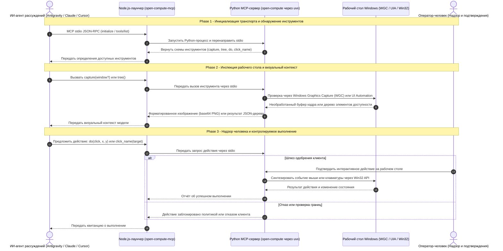

<p align="center">
  
</p>

# open-compute-mcp

> npm-лаунчер для Python-[MCP-сервера open-compute](https://github.com/ellmos-ai/open-compute). Он перенаправляет MCP JSON-RPC через локальные stdin/stdout. Для реального захвата экрана и ввода требуется интерактивный рабочий стол Windows на хосте MCP-клиента. Развёртывание на Glama или в других облачных/хостинговых средах рабочего стола не предоставляется.

Эта краткая входная страница заменяет подробный [README.md из предшествующего коммита 59cd953](https://github.com/ellmos-ai/open-compute-mcp/blob/59cd9530688b02c38b75d1926d5a1efdd1a4aa06/README.md). Исправленное подробное руководство [архивировано здесь](docs/archive/README-2026-10-12.md) с сохранением прежних якорей разделов и диаграмм. Это исправленная копия, а не неизменённый исторический снимок; оригинал остаётся доступным по ссылке на коммит.

[](https://github.com/ellmos-ai/open-compute-mcp/actions/workflows/ci.yml) [](https://www.npmjs.com/package/open-compute-mcp) [](test/) [](https://nodejs.org/) [](LICENSE) [](https://modelcontextprotocol.io) [](CHANGELOG.md) [](llms.txt) [](SKILL.md)

[English](README.md) | [Deutsch](README_de.md) | [Español](README_es.md) | [Français](README_fr.md) | [Português](README_pt.md) | **Русский** | [简体中文](README_zh.md) | [日本語](README_ja.md) | [العربية](README_ar.md) | [हिन्दी](README_hi.md) | [বাংলা](README_bn.md)

## Установка и запуск

Требуются Node.js 18 или новее и `uv`. Бэкенду требуется Python 3.10 или новее; `uvx` может использовать совместимый установленный интерпретатор либо скачать и настроить его при необходимости. По умолчанию запуск загружает Python-сервер из ветки `master` на GitHub; задайте `OPEN_COMPUTE_GIT_REF`, чтобы выбрать ветку, тег или коммит. Эти этапы начальной загрузки требуют доступа к сети.

Добавьте этот сервер в локальный MCP-клиент:

```json
{
  "mcpServers": {
    "open-compute": {
      "command": "npx",
      "args": ["-y", "open-compute-mcp"]
    }
  }
}
```

Пакет npm публикуется отдельно от этого Git-репозитория; проверяйте его опубликованную версию для конкретной ревизии исходного кода. Прямая конфигурация с `uvx` приведена в [подробном руководстве по быстрому старту](docs/archive/README-2026-10-12.md#sec-03).

## Архитектура и поток протокола

Лаунчер передаёт JSON-RPC-запросы клиента через локальный stdio к Python-движку, работающему на интерактивном рабочем столе Windows:



## Что делает лаунчер

Он запускает Python MCP-сервер и перенаправляет stdio. Обёртка не реализует сетевой фильтр, песочницу, сброс привилегий или очистку переменных окружения. Дочерний процесс наследует окружение и привилегии операционной системы лаунчера.

Команда `uvx` по умолчанию загружает Python-проект с GitHub; установка npm обращается к npm. В интерактивном терминале необязательное уведомление об обновлении может обращаться к npm. Локальный stdio описывает транспорт между клиентом и обёрткой; он не блокирует сетевой доступ ни для дочернего процесса, ни для MCP-клиента. Маршрутизацией результатов инструментов, включая снимки экрана, управляет клиент.

Для реального захвата и ввода запускайте MCP-клиент на том рабочем столе Windows, которым необходимо управлять. Режимы действий и выбор целей относятся к Python-серверу; настройте средства подтверждения клиента. Эта обёртка не является границей безопасности операционной системы.

## Инструменты и конфигурация

[Справочник инструментов](docs/archive/README-2026-10-12.md#sec-04) представляет собой снимок списка инструментов отдельного Python-проекта для задокументированной ревизии исходного кода. Доступные инструменты для выбранной ревизии определяются схемами запущенного сервера. См. также [переменные окружения](docs/archive/README-2026-10-12.md#sec-05).

## Связанная интеграция

[Cowork Protocol Desktop Companion](https://github.com/ellmos-ai/cowork-protocol/blob/main/apps/desktop-companion/README.md) включает необязательный адаптер управления компьютером, запускаемый человеком, который стартует отдельный Python MCP-сервер Open Compute через локальный stdio. В его задокументированной конфигурации по умолчанию используется `uvx`; этот npm-лаунчер не является зависимостью Cowork. Данная связь не изменяет описанные выше границы процессов, сети или привилегий.

## Документация

- [Архитектура и границы поведения](docs/archive/README-2026-10-12.md#sec-01)
- [Область безопасности и сети](docs/archive/README-2026-10-12.md#sec-12)
- [Перечень выбранных зависимостей](THIRD_PARTY_LICENSES.md)
- [Политика сообщений об уязвимостях](SECURITY.md)
- [Участие в разработке](CONTRIBUTING.md)
- [Журнал изменений](CHANGELOG.md)

Манифест исходного кода репозитория в настоящее время объявляет версию `0.1.0-alpha.20`. Эта работа над документацией не изменяет версию и не публикует релиз.
