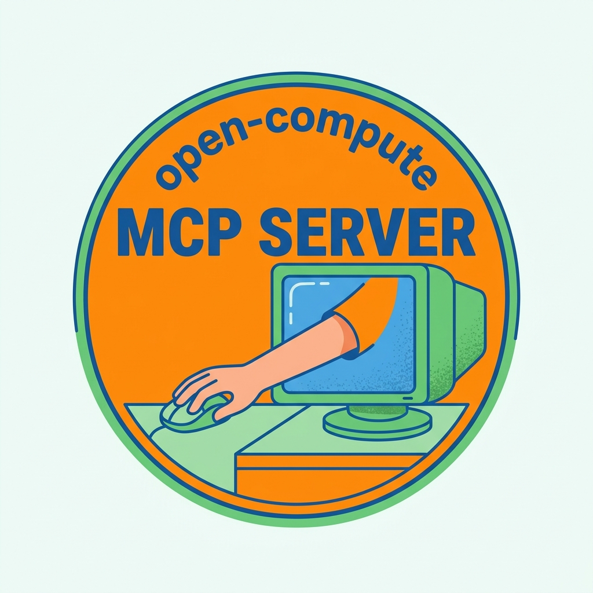
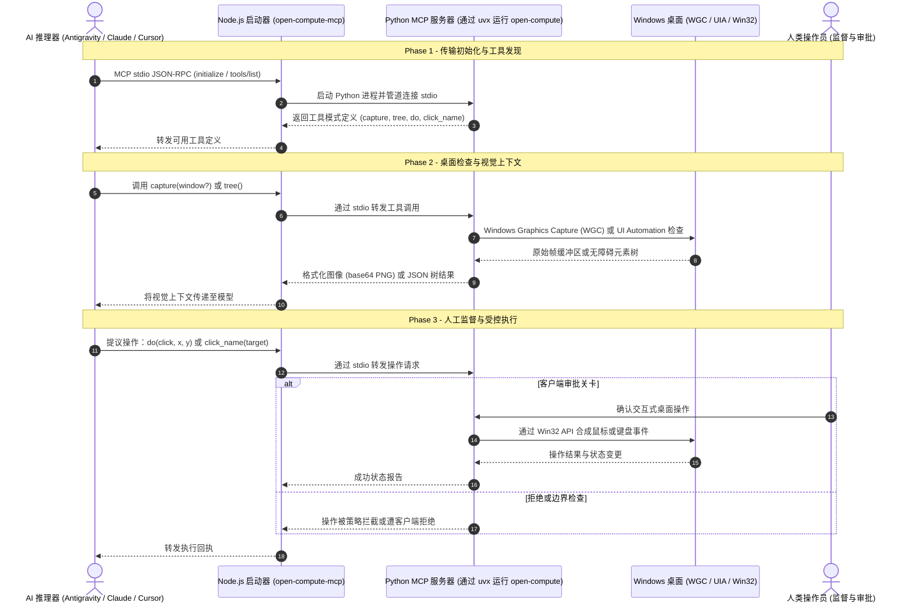

<p align="center">
  
</p>

# open-compute-mcp

> 面向 Python 版 [open-compute MCP 服务器](https://github.com/ellmos-ai/open-compute) 的 npm 启动器。它通过本地 stdin/stdout 转发 MCP JSON-RPC。实际的屏幕捕获与输入操作需要在 MCP 客户端所在主机上具备交互式 Windows 桌面。本包不提供 Glama 或其他托管/云端桌面部署。

此简短入口页替代了[前置提交 59cd953 中的长篇 README.md](https://github.com/ellmos-ai/open-compute-mcp/blob/59cd9530688b02c38b75d1926d5a1efdd1a4aa06/README.md)。修正后的详细指南已[归档于此](docs/archive/README-2026-10-12.md)，并保留了原有的章节锚点和图表。这是一份经修正的副本，而非未作修改的历史快照；原始版本仍可通过该提交链接查看。

[](https://github.com/ellmos-ai/open-compute-mcp/actions/workflows/ci.yml) [](https://www.npmjs.com/package/open-compute-mcp) [](test/) [](https://nodejs.org/) [](LICENSE) [](https://modelcontextprotocol.io) [](CHANGELOG.md) [](llms.txt)

[English](README.md) | [Deutsch](README_de.md) | [Español](README_es.md) | [Français](README_fr.md) | [Português](README_pt.md) | [Русский](README_ru.md) | **简体中文** | [日本語](README_ja.md) | [العربية](README_ar.md) | [हिन्दी](README_hi.md) | [বাংলা](README_bn.md)

## 安装与运行

需要 Node.js 18 或更高版本以及 `uv`。后端需要 Python 3.10 或更高版本；`uvx` 可使用已安装的兼容解释器，或在需要时自行下载并管理。默认启动会从 GitHub 的 `master` 分支拉取 Python 服务器；设置 `OPEN_COMPUTE_GIT_REF` 可指定分支、标签或提交。这些初始化引导步骤需要网络访问权限。

将此服务器添加到本地 MCP 客户端：

```json
{
  "mcpServers": {
    "open-compute": {
      "command": "npx",
      "args": ["-y", "open-compute-mcp"]
    }
  }
}
```

npm 包与本 Git 仓库分开发布；如需对应特定源码修订版，请核对已发布的 npm 版本。直接使用 `uvx` 的配置见[详细快速入门](docs/archive/README-2026-10-12.md#sec-03)。

## 架构与协议流程

启动器通过本地 stdio 将客户端的 JSON-RPC 请求桥接至运行在交互式 Windows 桌面上的 Python 引擎：



## 启动器的作用

它负责启动 Python MCP 服务器并转发 stdio。该包装器不实现网络过滤器、沙箱、权限降级或环境变量清理。子进程会继承启动器的环境变量与操作系统权限。

默认的 `uvx` 命令会从 GitHub 获取 Python 项目；npm 安装则会连接 npm。在交互式终端中，可选的更新提示可能会查询 npm。本地 stdio 仅描述客户端与包装器之间的传输方式，并不阻止子进程或 MCP 客户端访问网络。包括屏幕截图在内的工具结果如何路由均由客户端控制。

如需执行实际的屏幕捕获和输入，请在受控的 Windows 桌面上运行 MCP 客户端。操作模式与目标定位属于 Python 服务器的职责；请配置客户端的审批控制。此包装器不构成操作系统安全边界。

## 工具与配置

[工具参考](docs/archive/README-2026-10-12.md#sec-04)是独立 Python 项目在已记录源码引用处的工具列表快照。所选引用的可用工具由运行中服务器的模式定义决定。另请参阅[环境变量](docs/archive/README-2026-10-12.md#sec-05)。

## 相关集成

[Cowork Protocol Desktop Companion](https://github.com/ellmos-ai/cowork-protocol/blob/main/apps/desktop-companion/README.md) 包含一个可选的、由人工启动的计算机使用适配器，通过本地 stdio 启动独立的 Python 版 Open Compute MCP 服务器。其文档记录的默认配置使用 `uvx`；本 npm 启动器并非 Cowork 的依赖项。此关联不会改变上述进程、网络或权限边界。

## 文档

- [架构与行为范围](docs/archive/README-2026-10-12.md#sec-01)
- [安全与网络范围](docs/archive/README-2026-10-12.md#sec-12)
- [精选依赖清单](THIRD_PARTY_LICENSES.md)
- [安全报告策略](SECURITY.md)
- [贡献指南](CONTRIBUTING.md)
- [变更日志](CHANGELOG.md)

当前仓库源码清单声明的版本为 `0.1.0-alpha.20`。本次文档工作不更改任何版本，也不发布任何版本包。
