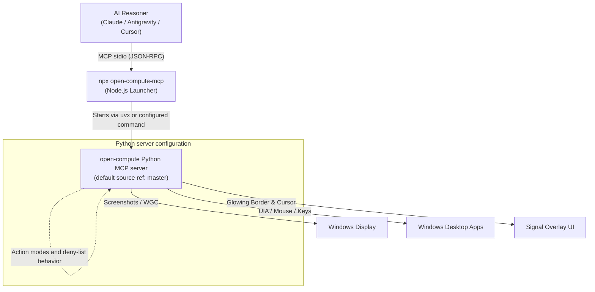
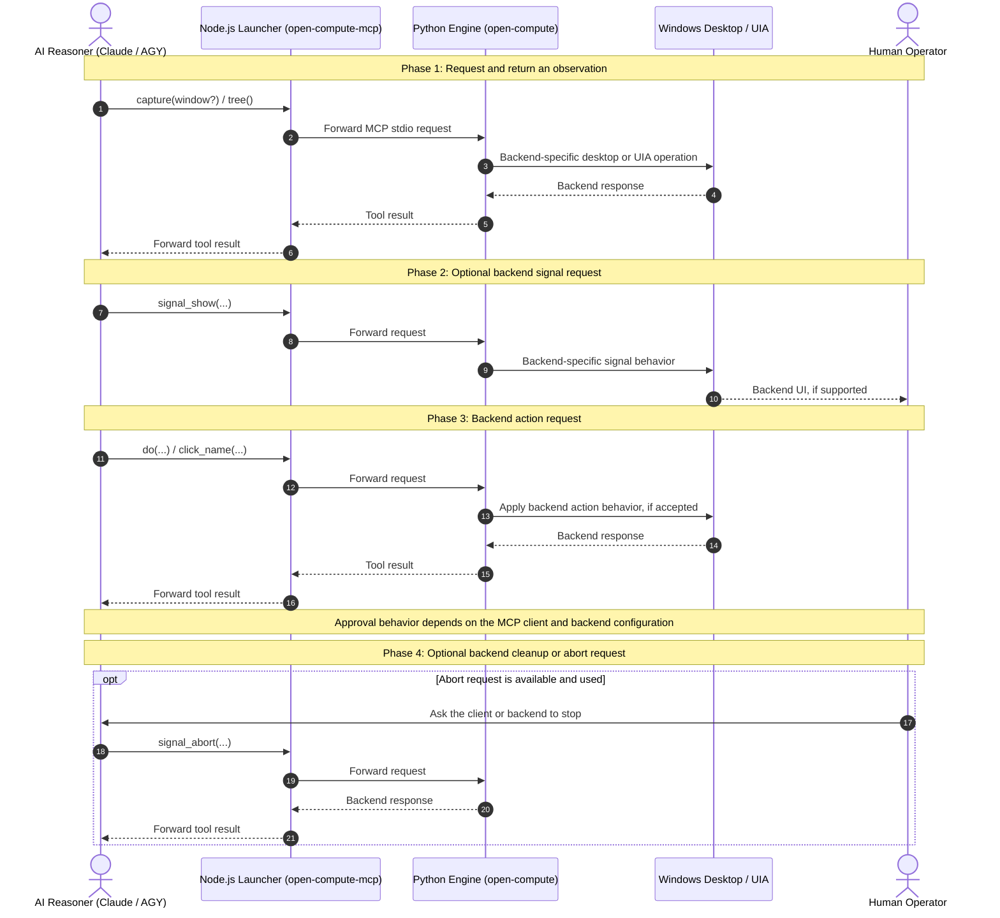

> Corrected archive dated 2026-10-12. This long-form guide is based on README.md at predecessor commit 59cd9530688b02c38b75d1926d5a1efdd1a4aa06, with current claim corrections while retaining its useful section structure, navigation aliases, and diagrams. The unchanged original is at https://github.com/ellmos-ai/open-compute-mcp/blob/59cd9530688b02c38b75d1926d5a1efdd1a4aa06/README.md.

<p align="center">
  
</p>

# open-compute-mcp

**npm launcher for the [open-compute](https://github.com/ellmos-ai/open-compute) MCP server** —
model-agnostic **computer-use** tools exposed over the Model Context Protocol (MCP).

> [!IMPORTANT]
> **Local client setup.** No supported Glama or other cloud-hosted desktop deployment is provided here.
> Real capture and input require an interactive Windows desktop on the MCP client's
> host. Install the launcher in a local MCP client.

**EN** | [DE](README_de-2026-10-12.md)

[](https://github.com/ellmos-ai/open-compute-mcp/actions/workflows/ci.yml)
[](https://www.npmjs.com/package/open-compute-mcp)
[](https://www.npmjs.com/package/open-compute-mcp)
[](https://github.com/ellmos-ai/open-compute-mcp)
[](../../LICENSE)
[](https://nodejs.org/)
[](../../CONTRIBUTING.md)
[](https://modelcontextprotocol.io)
[](../../NOTICE)
[](https://github.com/ellmos-ai)
[](https://github.com/open-bricks)
[](../../llms.txt)

📦 **[View on npm →](https://www.npmjs.com/package/open-compute-mcp)** • 📋 **[Security Policy](../../SECURITY.md)** • 🤝 **[Contributing Guidelines](../../CONTRIBUTING.md)** • ⚖️ **[Licenses](../../THIRD_PARTY_LICENSES.md)** • 🤖 **[LLM Context (llms.txt)](../../llms.txt)**

---

### Quick Navigation

- [1. 🏗️ Architecture](#architecture)
- [2. ✨ Backend Capabilities & Boundaries](#key-capabilities)
- [3. 🚀 Quick Start & Prerequisites](#quick-start) ([Use with an MCP Client](#use-with-an-mcp-client))
- [4. 🛠️ MCP Tool Reference](#tools)
- [5. ⚙️ Configuration & Environment](#configuration-environment-variables)
- [6. 🔄 Safe Interaction & Signal Lifecycle](#safe-interaction--signal-lifecycle)
- [7. 🎯 Example Use Cases](#target-personas--discoverability)
- [8. 🔍 Topics](#high-intent-search-term-matrix)
- [9. 📊 Component Responsibilities](#comparative-matrix-vs-alternatives)
- [10. 🏛️ Implementation Responsibilities & Limits](#governance--runtime-invariants)
- [11. 🌐 ellmos-ai Ecosystem & Sibling Matrix](#ellmos-ai-ecosystem)
- [12. 🔒 Security Policy & Transport Scope](#safety)
- [13. 📋 Selected Dependency Inventory](#level-1-sbom--invariant-matrix)
- [14. 🧪 Testing & Verification Suite](#testing--verification)
- [15. 📦 Registry Manifests & Schema Parity](#registry-manifests)
- [16. 🚦 Quality Gates & Pre-Release Checklist](#quality-gates)
- [17. ⚖️ Licensing & Canonical Attribution](#licensing--attribution)
- [18. 📜 Legal Notice & Maintainer Policy](#statutory-notice--security-response-sla)

| Direct Document References | [🛡️ Security Policy](../../SECURITY.md) • [🤝 Contributing Guidelines](../../CONTRIBUTING.md) • [⚖️ Third-Party Licenses](../../THIRD_PARTY_LICENSES.md) • [📜 Marketing Log](../../MARKETING-LOG.txt) • [🤖 LLM Context](../../llms.txt) • [📋 Canonical Notice](../../NOTICE) |
|---|---|

---

> [!NOTE]
> **AI assistant context**: [`llms.txt`](../../llms.txt) summarizes the wrapper and links to this guide. Tool schemas and backend behavior come from the separately fetched Python server.

The configured MCP client sends tool requests to the wrapper, which forwards them
to the Python server. The client controls its own model connection, approvals, and
handling of the results.

<a id="sec-01"></a><a id="architecture"></a><a id="architektur"></a>
## 1. Architecture



### Four-View System Architecture Topology

```text
+====================================================================================================+
|                     OPEN-COMPUTE-MCP — FOUR-VIEW SYSTEM ARCHITECTURE TOPOLOGY                     |
+====================================================================================================+

[VIEW 1: AI CALLER RUNTIMES & MULTI-AGENT CLIENTS]
  +------------------------------------------------------------------------------------------------+
  |  +--------------------+  +--------------------+  +--------------------+  +-------------------+ |
  |  | Claude Code / Desktop |  | Antigravity (AGY)  |  | Cursor / VS Code   |  | Custom MCP Agents | |
  |  +---------+----------+  +---------+----------+  +---------+----------+  +---------+---------+ |
  |            |                       |                       |                       |           |
  |            +-----------------------+-----------+-----------+-----------------------+           |
  |                                                | Model Context Protocol (MCP)                  |
  |                                                v Stdio JSON-RPC Transport                      |
  +------------------------------------------------------------------------------------------------+
                                                   |
[VIEW 2: NODE.JS LAUNCHER & PROTOCOL DISPATCH]
  +------------------------------------------------------------------------------------------------+
  |  npx open-compute-mcp (Node.js CommonJS process)                                               |
  |  - Forwards local stdio; does not filter network access                                        |
  |  - Command selection from environment (child inherits parent environment)                     |
  |  - Default uvx source ref: open-compute GitHub master; configurable via OPEN_COMPUTE_GIT_REF   |
  +------------------------------------------------+-----------------------------------------------+
                                                   | Stdio Process Stream
                                                   v (uvx --from git+https://github.com/ellmos-ai/...)
[VIEW 3: PYTHON OPEN-COMPUTE SERVER]
  +------------------------------------------------------------------------------------------------+
  |  open-compute Python server (default source ref: GitHub master)                                |
  |  +---------------------------+  +---------------------------+  +-----------------------------+ |
  |  | Vision & Perception       |  | Input & Semantic Tree     |  | Signal Overlay & Voice      | |
  |  | - capture (mss / WGC GPU) |  | - click_name (UIA tree)   |  | - signal_show (glowing UI)  | |
  |  | - coords / scale factors  |  | - invoke (pattern action) |  | - signal_abort (hotkey)     | |
  |  | - one-shot observation_id |  | - do (mouse / keyboard)   |  | - talk (push-to-talk WAV)   | |
  |  +---------------------------+  +---------------------------+  +-----------------------------+ |
  |                                                |                                               |
  |  +---------------------------------------------v---------------------------------------------+ |
  |  | Python server action modes (backend behavior)                                              | |
  |  | - OC_SAFETY_MODE / OC_DENY are interpreted by the Python server                            | |
  |  | - Tool approval and downstream routing are controlled by the MCP client                    | |
  |  +-------------------------------------------------------------------------------------------+ |
  +------------------------------------------------+-----------------------------------------------+
                                                   | Direct OS Windows Handles
                                                   v
[VIEW 4: HOST WINDOWS DESKTOP SESSION AND PROCESS BOUNDARY]
  +------------------------------------------------------------------------------------------------+
  |  Interactive Windows Desktop Session (Win32 / UIA / DirectX Graphics)                          |
  |  - Interactive desktop required for real capture and input                                     |
  |  - Python child inherits the launcher's environment and operating-system privileges            |
  |  - The launcher does not create an isolation boundary                                          |
  +------------------------------------------------------------------------------------------------+
```

> This package is a **thin launcher**. It starts the separate **Python** open-compute
> server (fetched from GitHub by the default command) and forwards MCP stdio.
> Real screen capture and input require the **interactive Windows desktop session**.

<a id="sec-02"></a><a id="key-capabilities"></a><a id="hauptfunktionen"></a>
## 2. Backend Capabilities & Boundaries

1. **Observation and Window APIs:** The Python server exposes capture/tree observations and window-targeting tools. Their validation and lifecycle behavior belong to that server revision.
2. **Action and UI Automation APIs:** The Python server exposes coordinate and UI Automation actions. Action modes and target validation are backend behavior, not controls implemented by this npm wrapper.
3. **Signals and Abort Controls:** The Python server exposes signal overlay and abort tools. Their timing and cleanup behavior are defined by that implementation.
4. **Additional Tools:** The tool set includes chat, voice recording, directory monitoring, and optional macro replay; consult the running server's schemas for exact behavior.

<a id="sec-03"></a><a id="quick-start"></a><a id="schnellstart"></a><a id="use-with-an-mcp-client"></a><a id="nutzung-mit-einem-mcp-client"></a>
## 3. Quick Start & Prerequisites

### Prerequisites

- **[uv](https://docs.astral.sh/uv/)** on the host. The backend requires Python 3.10+
  or newer; `uvx` can use an installed compatible interpreter or download and manage
  one when needed. The default launch fetches open-compute from GitHub and requires
  network access.
- An interactive Windows desktop on the MCP client's host for real capture/input.
  The Node.js CI matrix on other operating systems tests the launcher, not desktop control.

### Use with an MCP client

**Via this npm launcher (npx):**

```json
{
  "mcpServers": {
    "open-compute": {
      "command": "npx",
      "args": ["-y", "open-compute-mcp"]
    }
  }
}
```

**Directly via Python (`uvx`), without this npm launcher:**

```json
{
  "mcpServers": {
    "open-compute": {
      "command": "uvx",
      "args": ["--from", "open-compute[mcp,local,uia] @ git+https://github.com/ellmos-ai/open-compute.git@master", "open-compute-mcp"]
    }
  }
}
```

<a id="sec-04"></a><a id="tools"></a><a id="werkzeuge"></a>
## 4. MCP Tool Reference

The following 19 names match the Python project's README at commit
[`762cb15042f144d31e99e5834f9508dc9769dd66`](https://github.com/ellmos-ai/open-compute/blob/762cb15042f144d31e99e5834f9508dc9769dd66/README.md).
The wrapper defaults to the moving `master` ref unless `OPEN_COMPUTE_GIT_REF` is set;
the schemas exposed by the running server are authoritative for its selected ref.

`capture`, `observe_filtered`, `capture_filtered`, `do`, `tree`, `click_name`,
`invoke`, `list_windows`, `get_screen_size`, `watch_dir`, `push_status`,
`rec_replay`, `signal_show`, `signal_hide`, `signal_status`, `signal_abort`,
`chat`, `note_observation`, and `talk`.

Coordinate conventions and tool descriptions are defined by the Python server. Its
tool descriptions support the documented languages (`de/en/es/ja/ru/zh`) via
`OC_LANGUAGE`; check the running server's schema for exact behavior.

`do` may expose **hold primitives** such as `mouse_down` / `mouse_up` / `key_down` /
`key_up`, depending on the Python server version. Do not rely on this wrapper as an
independent input-release or process-tree cleanup mechanism.
`capture(window=...)` falls back to Windows.Graphics.Capture when a plain grab of
a hardware-composited window (Roblox Studio, Blender, a GPU-accelerated browser)
comes back all-black — install the `wgc` extra for that.

<a id="sec-05"></a><a id="configuration-environment-variables"></a><a id="konfiguration-umgebungsvariablen"></a>
## 5. Configuration (Environment Variables)

| Variable | Effect |
|---|---|
| `OPEN_COMPUTE_PYTHON` | Path to a `python.exe`; the launcher runs `-m open_compute.mcp_server` with it (use this if you installed open-compute into a specific environment). |
| `OPEN_COMPUTE_MCP_CMD` | Full command override (whitespace-split), e.g. `python -m open_compute.mcp_server`. |
| `OPEN_COMPUTE_GIT_REF` | Git ref (branch/tag/sha) for the uvx launch (default: `master`). |
| `OPEN_COMPUTE_EXTRAS` | Extras for the default `uvx` launch (default `mcp,local,uia`). |
| `OC_LANGUAGE` | Language of the tool descriptions: `de`/`en`/`es`/`ja`/`ru`/`zh`. |
| `OC_SAFETY_MODE` | `confirm` (default) · `read_only` · `allow_all`. |
| `OC_DENY` | Comma-separated action types configured as denied (e.g. `type,launch_app`); enforcement is implemented by the Python server. |
| `OC_CAPTURE_SCALE` | Capture scaling option interpreted by the Python server. |
| `OC_CAPTURE_MAX_DIM` | Maximum capture dimension option interpreted by the Python server. |
| `OC_CAPTURE_GRAYSCALE` | Grayscale option interpreted by the Python server. |
| `OC_SIGNAL_TTL` | Signal overlay timing option interpreted by the Python server. |
| `OC_SIGNAL_IDLE_HIDE` | Signal overlay timing option interpreted by the Python server. |
| `OC_SIGNAL_GRACE_SECONDS` | Pre-action countdown option interpreted by the Python server. |
| `OC_SIGNAL_CONFIG` | Signal configuration interpreted by the Python server. |

### Capture settings

`OC_CAPTURE_SCALE`, `OC_CAPTURE_MAX_DIM`, and `OC_CAPTURE_GRAYSCALE` are interpreted
by the Python server, not by this Node.js launcher. Image dimensions and token use
depend on the backend and the receiving model; pixel or token estimates are examples
for a particular combination, not package guarantees. Consult the Python project's
current guide before choosing capture settings. For coordinate actions, follow the
backend's observation and targeting requirements rather than reusing stale coordinates.

<a id="sec-06"></a><a id="safe-interaction--signal-lifecycle"></a><a id="sichere-interaktion--signal-lebenszyklus"></a>
## 6. Safe Interaction & Signal Lifecycle

The wrapper passes tool requests to the Python server. Observation IDs, window
descriptors, action modes, signal timing, and cleanup behavior are contracts of
the selected Python server revision; this npm package does not implement or
independently enforce them. Check that revision's tool schemas and guidance before
using coordinate actions or configuring action modes. The MCP client separately
controls its approval prompts and the routing of returned tool data.



<a id="sec-07"></a><a id="target-personas--discoverability"></a><a id="zielgruppen--auffindbarkeit"></a>
## 7. Example Use Cases

This interface may be useful to developers building MCP clients, Windows UI tests,
accessibility workflows, or human-reviewed desktop automation. It provides an npm
launcher; the Python server implements the computer-use tools, and the MCP client
controls its approval interface and result routing. These examples do not imply a
security certification or compatibility endorsement for a particular agent client.

<a id="sec-08"></a><a id="high-intent-search-term-matrix"></a><a id="hochrelevante-suchbegriffs-matrix"></a>
## 8. Topics

| Category | Primary Search Terms (English) | Primäre Suchbegriffe (Deutsch) |
|---|---|---|
| **MCP & Agent Tooling** | `model context protocol computer use`, `open compute mcp launcher`, `claude desktop gui automation` | `Model Context Protocol Computer Use`, `Open Compute MCP Server`, `Claude Desktop GUI Steuerung` |
| **UI Automation & Targeting** | `windows uia accessibility tree mcp`, `exact-first ui element targeting`, `semantic desktop automation` | `Windows UI Automation MCP`, `Semantische Desktop Steuerung`, `Barrierefreiheitsbaum Element Targeting` |
| **Client and process configuration** | `mcp client approval`, `desktop process privileges`, `local stdio transport` | `MCP-Client-Freigabe`, `Desktop-Prozessrechte`, `lokaler Stdio-Transport` |
| **Signals and interaction** | `screen signal overlay mcp`, `push-to-talk voice note mcp`, `Windows desktop MCP` | `Bildschirmsignal MCP`, `Push-to-Talk Sprachnotiz MCP`, `Windows Desktop MCP` |

<a id="sec-09"></a><a id="comparative-matrix-vs-alternatives"></a><a id="vergleichsmatrix-gegenueber-alternativen"></a>
## 9. Component Responsibilities

This section describes the roles of the components in the default launch path. It
does not compare or certify other products.

| Area | Current behavior | Boundary |
|---|---|---|
| Transport | MCP JSON-RPC is forwarded over local stdio. | Stdio is a transport, not a firewall or egress control. |
| Startup | npm installs this wrapper; the default `uvx` command retrieves the Python project from GitHub. | These bootstrap steps use the network. |
| Child process | The wrapper starts the configured command and forwards stdio. | The child inherits the launching process's environment and operating-system privileges. |
| Desktop access | Real capture and input require an interactive Windows desktop on the MCP client's host. | This repository does not provide hosted desktop execution. |
| Approval and action modes | The Python server implements its configured action behavior; the MCP client controls its own approval interface and result routing. | This wrapper does not enforce client or provider policies. |

Links to separate projects elsewhere in this guide do not imply integration, support,
or comparative claims.

<a id="sec-10"></a><a id="governance--runtime-invariants"></a><a id="governance--laufzeit-invarianten"></a>
## 10. Implementation Responsibilities & Limits

| Area | Implemented by | Scope |
|---|---|---|
| Command selection and stdio forwarding | This Node.js launcher | Resolves documented environment overrides, spawns a child process, and forwards stdin/stdout/stderr. |
| Python server behavior | The separately distributed `open-compute` project | Capture, desktop input, action modes, and tool behavior depend on the selected Python source and configuration. |
| Process boundary | Operating system | The child inherits the launching process's environment and privileges. This wrapper does not create a sandbox or drop privileges. |
| Network access | Installer, launcher dependencies, child process, and MCP client | npm and the default GitHub-based `uvx` bootstrap use network access; this package adds no network-blocking control. |
| Verification | Repository tests and GitHub Actions | Tests cover wrapper functions, metadata, repository checks, and package dry-run. They are not a live-provider, live-desktop, or network-isolation certification. |
| Vulnerability reporting | Maintainer policy in [SECURITY.md](../../SECURITY.md) | Published response targets are governance policy, not a runtime invariant. |

The former `INV-*` labels were documentation labels. They do not establish security certification or enforcement beyond the implementations and checks described above.

<a id="sec-11"></a><a id="ellmos-ai-ecosystem"></a><a id="ellmos-ai-ökosystem"></a>
## 11. ellmos-ai Ecosystem & Sibling Matrix

This repository is published under the **[ellmos-ai](https://github.com/ellmos-ai)** organization. The linked repositories are separate projects; this table does not claim interoperability or endorsement.

### MCP Server Family

| Project | Repository |
|---|---|
| FileCommander | [ellmos-filecommander-mcp](https://github.com/ellmos-ai/ellmos-filecommander-mcp) |
| CodeCommander | [ellmos-codecommander-mcp](https://github.com/ellmos-ai/ellmos-codecommander-mcp) |
| Clatcher | [ellmos-clatcher-mcp](https://github.com/ellmos-ai/ellmos-clatcher-mcp) |
| n8n Manager | [n8n-manager-mcp](https://github.com/ellmos-ai/n8n-manager-mcp) |
| ControlCenter | [ellmos-controlcenter-mcp](https://github.com/ellmos-ai/ellmos-controlcenter-mcp) |
| Homebase | [ellmos-homebase-mcp](https://github.com/ellmos-ai/ellmos-homebase-mcp) |
| ServerCommander | [ellmos-servercommander-mcp](https://github.com/ellmos-ai/ellmos-servercommander-mcp) |
| Blender Use | [ellmos-blender-use-mcp](https://github.com/ellmos-ai/ellmos-blender-use-mcp) |
| Open Compute | [open-compute-mcp](https://github.com/ellmos-ai/open-compute-mcp) |

### AI Infrastructure & Sibling Tooling

| Project | Repository |
|---|---|
| [BACH](https://github.com/ellmos-ai/bach) | Separate repository |
| [open-compute](https://github.com/ellmos-ai/open-compute) | Separate Python backend repository used by the default launch command |
| [clutch](https://github.com/ellmos-ai/clutch) | Separate repository |
| [rinnsal](https://github.com/ellmos-ai/rinnsal) | Separate repository |
| [ellmos-stack](https://github.com/ellmos-ai/ellmos-stack) | Separate repository |
| [MarbleRun](https://github.com/ellmos-ai/MarbleRun) | Separate repository |
| [gardener](https://github.com/ellmos-ai/gardener) | Separate repository |
| [ellmos-tests](https://github.com/ellmos-ai/ellmos-tests) | Separate repository |
| [sqlite-transit-sync](https://github.com/ellmos-ai/sqlite-transit-sync) | Separate repository |
| [policy-registry](https://github.com/ellmos-ai/policy-registry) | Separate repository |

### Open Bricks Umbrella

Related organization: [open-bricks](https://github.com/open-bricks). Other linked repositories include [DevCenter](https://github.com/dev-bricks/DevCenter), [CodeBox](https://github.com/dev-bricks/CodeBox), [MethodenAnalyser](https://github.com/dev-bricks/MethodenAnalyser), [CleanMarkdown](https://github.com/doc-bricks/CleanMarkdown), and [PDFtoPDFocr](https://github.com/doc-bricks/PDFtoPDFocr). These are separate projects; see their own documentation for supported integrations.

<a id="sec-12"></a><a id="safety"></a><a id="sicherheit"></a>
## 12. Security Policy & Transport Scope

The launcher forwards MCP JSON-RPC over local stdio and starts the Python server. The default `uvx` command retrieves `open-compute` from GitHub; npm installation retrieves this wrapper from npm. When launched from an interactive terminal, the optional update notice may check npm.

The wrapper does not implement a firewall, network block, sandbox, environment scrubber, or privilege drop. Its child inherits the launching process's environment and operating-system privileges. Local stdio describes the client-to-wrapper transport; it does not limit what the child or MCP client can access.

Action modes such as `OC_SAFETY_MODE` and `OC_DENY` are interpreted by the Python server. Review that project's documentation and configure the MCP client's approval controls for the environment in which it runs. The client controls downstream handling of tool results, including screenshot images.

Treat on-screen text and images as untrusted input. Real capture and input require an interactive Windows desktop on the MCP client's host; this launcher does not provide access to a separate remote desktop.

<a id="sec-13"></a><a id="level-1-sbom--invariant-matrix"></a><a id="level-1-sbom--invarianten-matrix"></a>
## 13. Selected Dependency Inventory

This dated inventory records selected package metadata; it is not a complete SBOM, legal opinion, or supply-chain certification.

### Direct npm runtime dependency

| Package | Locked version | Declared license | Use |
|---|---:|---|---|
| `update-notifier` | 7.3.1 | BSD-2-Clause | Optional interactive-terminal update notice |

The dependency tree for the Git repository is recorded in [package-lock.json](https://github.com/ellmos-ai/open-compute-mcp/blob/main/package-lock.json). The npm package's transitive dependencies have their own metadata and license notices. Node.js, the separately fetched Python project, optional Python extras, MCP clients, and any provider tools are outside this selected npm dependency row. Each distributed component must be assessed within its own distribution context.

The repository's own license is MIT; see [LICENSE](../../LICENSE). This inventory does not claim that the full toolchain or every downstream deployment is free of reciprocal licenses.

<a id="sec-14"></a><a id="testing--verification"></a><a id="tests--verifikation"></a>
## 14. Testing & Verification Suite

The repository's Node.js tests cover launcher behavior, repository metadata, documentation links, and packaging-related checks. They do not exercise a live desktop, the separately fetched Python server, or network isolation.

```bash
# Run all automated tests
npm test

# Run repository hygiene checks
npm run test:hygiene

# Preview npm package contents
npm pack --dry-run
```

The configured GitHub Actions workflow runs these checks on Ubuntu, Windows, and
macOS with Node.js 18, 20, 22, and 24. A successful CI run reports that run's
results; it is not a live-provider, desktop, or network-isolation test.

<a id="sec-15"></a><a id="registry-manifests"></a><a id="registry-manifeste"></a>
## 15. Registry Manifests & Schema Parity

This repository contains the following package and discovery metadata files. Their
presence does not by itself mean that a remote hosting or deployment service is supported.

| Manifest | Schema / Specification | Purpose |
|---|---|---|
| [`package.json`](../../package.json) | npm package format (CommonJS) | Defines launcher executable, keywords, and distribution files whitelist |
| [`server.json`](../../server.json) | MCP server metadata schema | Describes the npm package and stdio launch |
| [`glama.json`](../../glama.json) | Glama metadata schema | Repository listing metadata; no hosted desktop execution is provided here |
| [`smithery.yaml`](../../smithery.yaml) | Smithery metadata | Declares a command-line launch invocation |
| [`llms.txt`](../../llms.txt) | Project context index | Machine-readable summary of this repository |

<a id="sec-16"></a><a id="quality-gates"></a><a id="qualitaets-gates"></a>
## 16. Quality Gates & Pre-Release Checklist

Suggested pre-PR checks for contributors:
1. Review the working-tree diff and avoid adding local scratch files or credentials.
2. Check changed text as UTF-8 and inspect rendered links, tables, and diagrams.
3. Run `npm test`, `npm pack --dry-run`, and `git diff --check` when relevant.
4. Keep package and discovery metadata consistent, and do not change the declared version without release authorization.

CI results and branch protection are separate repository settings; the workflow alone
does not require these checks for every possible branch update.

<a id="sec-17"></a><a id="licensing--attribution"></a><a id="lizenzierung--attribution"></a>
## 17. Licensing & Canonical Attribution

Distributed under the **MIT License**. See [LICENSE](../../LICENSE) for full legal text.

Part of the **[ellmos-ai](https://github.com/ellmos-ai)** family under the **[open-bricks](https://github.com/open-bricks)** open-source umbrella.
Canonical attribution and dependency inventory are documented in [NOTICE](../../NOTICE), [THIRD_PARTY_LICENSES.md](../../THIRD_PARTY_LICENSES.md), and [THIRD_PARTY_LICENSES.txt](../../THIRD_PARTY_LICENSES.txt).

<a id="sec-18"></a><a id="statutory-notice--security-response-sla"></a><a id="gesetzlicher-hinweis--sicherheits-reaktions-sla"></a>
## 18. Legal Notice & Maintainer Policy

The project is provided under the MIT license. Whether statutory rules such as section 521 BGB apply depends on the legal relationship and applicable law; this documentation does not provide a blanket exemption from liability.

The current maintainer response policy is published in [SECURITY.md](../../SECURITY.md). Those response targets are a governance commitment, not a runtime guarantee.
