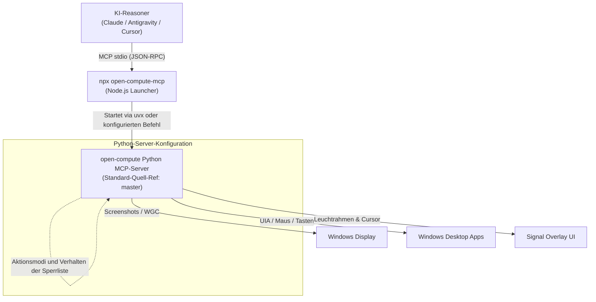
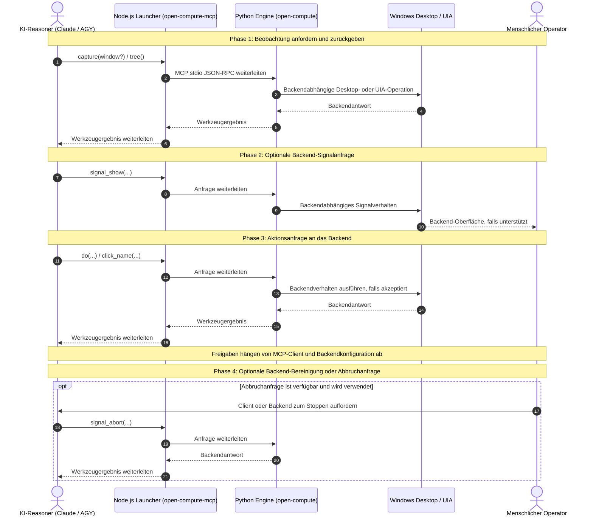

> Korrigiertes Archiv vom 12.10.2026. Dieser ausführliche Leitfaden basiert auf README_de.md aus dem Vorgänger-Commit 59cd9530688b02c38b75d1926d5a1efdd1a4aa06. Aktuelle Aussagen wurden eingegrenzt; nützliche Abschnittsstruktur, Navigationsanker und Diagramme bleiben erhalten. Das unveränderte Original steht unter https://github.com/ellmos-ai/open-compute-mcp/blob/59cd9530688b02c38b75d1926d5a1efdd1a4aa06/README_de.md.

<p align="center">
  
</p>

# open-compute-mcp

**npm-Launcher für den [open-compute](https://github.com/ellmos-ai/open-compute) MCP-Server** —
modellagnostische **Computer-Use**-Tools über das Model Context Protocol (MCP).

> [!IMPORTANT]
> **Lokale Client-Einrichtung.** Dieses Repository bietet keine gehostete Desktop-Ausführung über Glama oder andere Cloud-Dienste.
> Echte Bildschirmaufnahme und Eingaben erfordern einen
> interaktiven Windows-Desktop auf dem Host des MCP-Clients. Richte den Launcher
> in einem lokalen MCP-Client ein.

**EN** ([README.md](README-2026-10-12.md)) | **DE**

[](https://github.com/ellmos-ai/open-compute-mcp/actions/workflows/ci.yml)
[](https://www.npmjs.com/package/open-compute-mcp)
[](https://www.npmjs.com/package/open-compute-mcp)
[](https://github.com/ellmos-ai/open-compute-mcp)
[](../../LICENSE)
[](https://nodejs.org/)
[](../../CONTRIBUTING.md)
[](https://modelcontextprotocol.io)
[](../../NOTICE)
[](https://github.com/ellmos-ai)
[](https://github.com/open-bricks)
[](../../llms.txt)

📦 **[Auf npm ansehen →](https://www.npmjs.com/package/open-compute-mcp)** • 📋 **[Sicherheitsrichtlinie](../../SECURITY.md)** • 🤝 **[Richtlinien für Mitwirkende](../../CONTRIBUTING.md)** • ⚖️ **[Lizenzen](../../THIRD_PARTY_LICENSES.md)** • 🤖 **[LLM-Kontext (llms.txt)](../../llms.txt)**

---

### Schnellnavigation

- [1. 🏗️ Architektur](#architektur)
- [2. ✨ Backend-Funktionen und Grenzen](#hauptfunktionen)
- [3. 🚀 Schnellstart & Voraussetzungen](#schnellstart) ([Nutzung mit einem MCP-Client](#nutzung-mit-einem-mcp-client))
- [4. 🛠️ MCP-Werkzeugreferenz](#werkzeuge)
- [5. ⚙️ Konfiguration & Umgebungsvariablen](#konfiguration-umgebungsvariablen)
- [6. 🔄 Sichere Interaktion & Signal-Lebenszyklus](#sichere-interaktion--signal-lebenszyklus)
- [7. 🎯 Beispielanwendungen](#zielgruppen--auffindbarkeit)
- [8. 🔍 Themen](#hochrelevante-suchbegriffs-matrix)
- [9. 📊 Verhaltensumfang und Vergleichsgrenzen](#vergleichsmatrix-gegenueber-alternativen)
- [10. 🏛️ Zuständigkeiten und Implementierungsgrenzen](#governance--laufzeit-invarianten)
- [11. 🌐 ellmos-ai Ökosystem & Partner-Matrix](#ellmos-ai-ökosystem)
- [12. 🔒 Sicherheitsrichtlinie und Transportumfang](#sicherheit)
- [13. 📋 Ausgewähltes Abhängigkeitsinventar](#level-1-sbom--invarianten-matrix)
- [14. 🧪 Test- & Verifikationssuite](#tests--verifikation)
- [15. 📦 Registry-Manifeste & Schema-Parität](#registry-manifeste)
- [16. 🚦 Qualitäts-Gates & Pre-Release Checkliste](#qualitaets-gates)
- [17. ⚖️ Lizenzierung & Kanonische Attribution](#lizenzierung--attribution)
- [18. 📜 Rechtlicher Hinweis und Maintainer-Richtlinie](#gesetzlicher-hinweis--sicherheits-reaktions-sla)

| Direkte Dokumentenreferenzen | [🛡️ Sicherheitsrichtlinie](../../SECURITY.md) • [🤝 Richtlinien für Mitwirkende](../../CONTRIBUTING.md) • [⚖️ Drittanbieter-Lizenzen](../../THIRD_PARTY_LICENSES.md) • [📜 Marketingprotokoll](../../MARKETING-LOG.txt) • [🤖 LLM-Kontext](../../llms.txt) • [📋 Kanonischer Hinweis](../../NOTICE) |
|---|---|

---

> [!NOTE]
> **Kontext für KI-Assistenten**: [`llms.txt`](../../llms.txt) fasst den Wrapper zusammen und verlinkt auf diesen Leitfaden. Werkzeugschemata und Backend-Verhalten stammen vom separat geladenen Python-Server.

Der konfigurierte MCP-Client sendet Werkzeuganfragen an den Wrapper, der sie an den
Python-Server weiterleitet. Der Client steuert seine Modellverbindung, Freigaben und
die weitere Verarbeitung der Ergebnisse.

<a id="sec-01"></a><a id="architecture"></a><a id="architektur"></a>
## 1. Architektur



### Vier-Ebenen-Systemarchitektur-Topologie

```text
+====================================================================================================+
|                     OPEN-COMPUTE-MCP — VIER-EBENEN-SYSTEMARCHITEKTUR-TOPOLOGIE                    |
+====================================================================================================+

[EBENE 1: KI-AGENTEN-RUNTIMES & MULTI-AGENT-CLIENTS]
  +------------------------------------------------------------------------------------------------+
  |  +--------------------+  +--------------------+  +--------------------+  +-------------------+ |
  |  | Claude Code / Desktop |  | Antigravity (AGY)  |  | Cursor / VS Code   |  | Eigene MCP-Agenten| |
  |  +---------+----------+  +---------+----------+  +---------+----------+  +---------+---------+ |
  |            |                       |                       |                       |           |
  |            +-----------------------+-----------+-----------+-----------------------+           |
  |                                                | Model Context Protocol (MCP)                  |
  |                                                v Stdio JSON-RPC Transport                      |
  +------------------------------------------------------------------------------------------------+
                                                   |
[EBENE 2: NODE.JS LAUNCHER & PROTOKOLL-DISPATCH]
  +------------------------------------------------------------------------------------------------+
  |  npx open-compute-mcp (Node.js CommonJS-Prozess)                                               |
  |  - Leitet lokales stdio weiter; filtert keinen Netzwerkzugriff                                 |
  |  - Befehlsauswahl über Umgebung (Kindprozess erbt Elternumgebung)                              |
  |  - Standard-Ref: GitHub master; änderbar über OPEN_COMPUTE_GIT_REF                             |
  +------------------------------------------------+-----------------------------------------------+
                                                   | Stdio-Prozess-Stream
                                                   v (uvx --from git+https://github.com/ellmos-ai/...)
[EBENE 3: PYTHON OPEN-COMPUTE SERVER]
  +------------------------------------------------------------------------------------------------+
  |  open-compute Python-Server (Standard-Quell-Ref: GitHub master)                                |
  |  +---------------------------+  +---------------------------+  +-----------------------------+ |
  |  | Wahrnehmung & Vision      |  | Eingabe & Semantischer Baum| | Signal-Overlay & Audio       | |
  |  | - capture (mss / WGC GPU) |  | - click_name (UIA-Baum)   |  | - signal_show (Overlay-UI)  | |
  |  | - Koordinaten / Skalierung|  | - invoke (Muster-Aktion)  |  | - signal_abort (Not-Halt)   | |
  |  | - Ephemere observation_id |  | - do (Maus / Tastatur)    |  | - talk (Push-to-Talk WAV)   | |
  |  +---------------------------+  +---------------------------+  +-----------------------------+ |
  |                                                |                                               |
  |  +---------------------------------------------v---------------------------------------------+ |
  |  | Aktionsmodi des Python-Servers (Backend-Verhalten)                                         | |
  |  | - OC_SAFETY_MODE / OC_DENY werden vom Python-Server verarbeitet                            | |
  |  | - Tool-Freigaben und Ergebnisweiterleitung steuert der MCP-Client                          | |
  |  +-------------------------------------------------------------------------------------------+ |
  +------------------------------------------------+-----------------------------------------------+
                                                   | Direkte Windows-Handles
                                                   v
[EBENE 4: WINDOWS-DESKTOP UND PROZESSGRENZE]
  +------------------------------------------------------------------------------------------------+
  |  Interaktive Windows-Desktop-Sitzung (Win32 / UIA / DirectX Graphics)                          |
  |  - Kindprozess erbt Umgebung und Betriebssystemrechte des Launchers                            |
  |  - Der Launcher erzeugt keine Isolationsgrenze                                                 |
  +------------------------------------------------------------------------------------------------+
```

> Dieses Paket ist ein **dünner Launcher**. Es startet den separaten **Python**-Server
> (open-compute; Standardabruf von GitHub) und leitet MCP-stdio weiter. Echtes
> Capture/Input braucht die interaktive **Windows**-Desktop-Session.

<a id="sec-02"></a><a id="key-capabilities"></a><a id="hauptfunktionen"></a>
## 2. Backend-Funktionen und Grenzen

1. **Beobachtungs- und Fenster-APIs:** Der Python-Server stellt Aufnahme-/Baumansichten und Werkzeuge für Fensterziele bereit. Validierung und Lebenszyklus hängen von seiner Quellversion ab.
2. **Aktions- und UI-Automation-APIs:** Der Python-Server stellt Koordinaten- und UI-Automation-Aktionen bereit. Aktionsmodi und Zielprüfung implementiert das Backend, nicht dieser npm-Launcher.
3. **Signale und Abbruch:** Der Python-Server bietet Werkzeuge für Signal-Overlay und Abbruch. Timing und Bereinigung richten sich nach dessen Implementierung.
4. **Weitere Werkzeuge:** Die Werkzeugliste umfasst Chat, Sprachaufnahme, Verzeichnisüberwachung und optionales Makro-Replay; genaue Details stehen in den Schemata des laufenden Servers.

<a id="sec-03"></a><a id="quick-start"></a><a id="schnellstart"></a><a id="use-with-an-mcp-client"></a><a id="nutzung-mit-einem-mcp-client"></a>
## 3. Schnellstart & Voraussetzungen

### Voraussetzungen

- **[uv](https://docs.astral.sh/uv/)** auf dem Host. Das Backend benötigt Python 3.10
  oder neuer; `uvx` kann einen passenden installierten Interpreter verwenden oder bei
  Bedarf selbst einen herunterladen und verwalten. Der Standardstart ruft
  open-compute von GitHub ab und benötigt Netzwerkzugriff.
- Einen interaktiven Windows-Desktop auf dem Host des MCP-Clients für echte Aufnahme
  und Eingaben. CI auf anderen Betriebssystemen prüft den Node.js-Launcher, nicht die Desktopsteuerung.

### Nutzung mit einem MCP-Client

**Über diesen npm-Launcher (npx):**

```json
{
  "mcpServers": {
    "open-compute": {
      "command": "npx",
      "args": ["-y", "open-compute-mcp"]
    }
  }
}
```

**Direkt über Python (`uvx`), ohne diesen npm-Launcher:**

```json
{
  "mcpServers": {
    "open-compute": {
      "command": "uvx",
      "args": ["--from", "open-compute[mcp,local,uia] @ git+https://github.com/ellmos-ai/open-compute.git@master", "open-compute-mcp"]
    }
  }
}
```

<a id="sec-04"></a><a id="tools"></a><a id="werkzeuge"></a>
## 4. MCP-Werkzeugreferenz

Die folgenden 19 Namen entsprechen dem README des Python-Projekts am Commit
[`762cb15042f144d31e99e5834f9508dc9769dd66`](https://github.com/ellmos-ai/open-compute/blob/762cb15042f144d31e99e5834f9508dc9769dd66/README.md).
Der Wrapper verwendet standardmäßig den veränderlichen Ref `master`, sofern
`OPEN_COMPUTE_GIT_REF` nicht gesetzt ist. Maßgeblich sind die Schemas des gestarteten
Servers für den tatsächlich gewählten Ref.

`capture`, `observe_filtered`, `capture_filtered`, `do`, `tree`, `click_name`,
`invoke`, `list_windows`, `get_screen_size`, `watch_dir`, `push_status`,
`rec_replay`, `signal_show`, `signal_hide`, `signal_status`, `signal_abort`,
`chat`, `note_observation` und `talk`.

Koordinatenkonventionen und Werkzeugbeschreibungen legt der Python-Server fest. Seine
Werkzeugtexte unterstützen die dokumentierten Sprachen (`de/en/es/ja/ru/zh`) über
`OC_LANGUAGE`; genaue Details stehen im Schema des laufenden Servers.

Je nach Version des Python-Servers kann `do` **Halte-Primitive** wie `mouse_down` /
`mouse_up` / `key_down` / `key_up` anbieten. Verlasse dich nicht auf diesen Wrapper
als unabhängige Eingabefreigabe oder Prozessbaum-Bereinigung.

<a id="sec-05"></a><a id="configuration-environment-variables"></a><a id="konfiguration-umgebungsvariablen"></a>
## 5. Konfiguration (Umgebungsvariablen)

| Variable | Wirkung |
|---|---|
| `OPEN_COMPUTE_PYTHON` | Pfad zu einer `python.exe`; startet damit `-m open_compute.mcp_server`. |
| `OPEN_COMPUTE_MCP_CMD` | Voller Befehls-Override (per Leerzeichen getrennt). |
| `OPEN_COMPUTE_GIT_REF` | Git-Ref (Branch/Tag/SHA) für den uvx-Start (Standard: `master`). |
| `OPEN_COMPUTE_EXTRAS` | Extras für den uvx-Launch (Default `mcp,local,uia`). |
| `OC_LANGUAGE` | Sprache der Tool-Beschreibungen: `de`/`en`/`es`/`ja`/`ru`/`zh`. |
| `OC_SAFETY_MODE` | `confirm` (Default) · `read_only` · `allow_all`. |
| `OC_DENY` | Kommagetrennte Aktionstypen, die als verweigert konfiguriert sind; die Durchsetzung erfolgt im Python-Server. |
| `OC_CAPTURE_SCALE` | Aufnahme-Skalierungsoption, die der Python-Server interpretiert. |
| `OC_CAPTURE_MAX_DIM` | Option für die maximale Aufnahmedimension des Python-Servers. |
| `OC_CAPTURE_GRAYSCALE` | Graustufenoption, die der Python-Server interpretiert. |
| `OC_SIGNAL_TTL` | Timingoption des Signal-Overlays im Python-Server. |
| `OC_SIGNAL_IDLE_HIDE` | Timingoption des Signal-Overlays im Python-Server. |
| `OC_SIGNAL_GRACE_SECONDS` | Vorlaufoption, die der Python-Server interpretiert. |
| `OC_SIGNAL_CONFIG` | Signalkonfiguration, die der Python-Server interpretiert. |

### Aufnahmeeinstellungen

`OC_CAPTURE_SCALE`, `OC_CAPTURE_MAX_DIM` und `OC_CAPTURE_GRAYSCALE` verarbeitet der
Python-Server, nicht dieser Node.js-Launcher. Bildabmessungen und Tokenverbrauch hängen
vom Backend und dem empfangenden Modell ab; Pixel- oder Token-Schätzungen gelten nur für
eine konkrete Kombination. Prüfe vor der Wahl der Einstellungen den aktuellen Leitfaden
des Python-Projekts. Bei Koordinatenaktionen gelten die Beobachtungs- und Zielregeln des
Backends; verwende keine veralteten Koordinaten erneut.

<a id="sec-06"></a><a id="safe-interaction--signal-lifecycle"></a><a id="sichere-interaktion--signal-lebenszyklus"></a>
## 6. Sichere Interaktion & Signal-Lebenszyklus

Der Wrapper leitet Werkzeuganfragen an den Python-Server weiter. Beobachtungs-IDs,
Fensterdeskriptoren, Aktionsmodi, Signal-Timing und Bereinigung sind Verträge der
jeweils verwendeten Python-Server-Version; dieses npm-Paket implementiert oder
erzwingt sie nicht unabhängig. Prüfe vor Koordinatenaktionen und der Konfiguration
von Aktionsmodi die Werkzeugschemata und Hinweise dieser Version. Der MCP-Client
steuert separat seine Freigabedialoge und die Weiterleitung der Werkzeugdaten.



<a id="sec-07"></a><a id="target-personas--discoverability"></a><a id="zielgruppen--auffindbarkeit"></a>
## 7. Beispielanwendungen

Die Schnittstelle kann für Entwickler von MCP-Clients, Windows-UI-Tests,
Barrierefreiheitsabläufen oder menschlich überprüfter Desktop-Automatisierung
interessant sein. Sie stellt einen npm-Launcher bereit; der Python-Server
implementiert die Computer-Use-Werkzeuge, der MCP-Client steuert Freigaben und
Ergebnisweiterleitung. Diese Beispiele sind keine Sicherheitszertifizierung oder
Kompatibilitätsbestätigung für einen bestimmten Agenten-Client.

<a id="sec-08"></a><a id="high-intent-search-term-matrix"></a><a id="hochrelevante-suchbegriffs-matrix"></a>
## 8. Themen

| Kategorie | Primäre Suchbegriffe (Deutsch) | Primary Search Terms (English) |
|---|---|---|
| **MCP & Agent Tooling** | `Model Context Protocol Computer Use`, `Open Compute MCP Server`, `Claude Desktop GUI Steuerung` | `model context protocol computer use`, `open compute mcp launcher`, `claude desktop gui automation` |
| **UI Automation & Targeting** | `Windows UI Automation MCP`, `Semantische Desktop Steuerung`, `Barrierefreiheitsbaum Element Targeting` | `windows uia accessibility tree mcp`, `exact-first ui element targeting`, `semantic desktop automation` |
| **Client- und Prozesskonfiguration** | `MCP-Client-Freigabe`, `Desktop-Prozessrechte`, `lokaler Stdio-Transport` | `mcp client approval`, `desktop process privileges`, `local stdio transport` |
| **Signale und Interaktion** | `Bildschirmsignal MCP`, `Push-to-Talk-Sprachnotiz MCP`, `Windows Desktop MCP` | `screen signal overlay mcp`, `push-to-talk voice note mcp`, `Windows desktop MCP` |

<a id="sec-09"></a><a id="comparative-matrix-vs-alternatives"></a><a id="vergleichsmatrix-gegenueber-alternativen"></a>
## 9. Komponentenverantwortlichkeiten

Dieser Abschnitt beschreibt den Launcher. Er ist keine vergleichende Sicherheitsbewertung anderer Produkte.

| Bereich | Aktuelles Verhalten | Grenze |
|---|---|---|
| Transport | MCP-JSON-RPC wird über lokales stdio weitergeleitet. | Stdio ist ein Transport, keine Firewall oder Egress-Sperre. |
| Start | npm installiert diesen Wrapper; der `uvx`-Standardbefehl ruft das Python-Projekt von GitHub ab. | Diese Abrufschritte verwenden das Netzwerk. |
| Kindprozess | Der Wrapper startet den konfigurierten Python-Befehl und vererbt Umgebung und Betriebssystemrechte. | Er isoliert den Kindprozess nicht in einer Sandbox und senkt keine Rechte ab. |
| Desktopzugriff | Echte Bildschirmaufnahme und Eingaben benötigen einen interaktiven Windows-Desktop auf dem Host des MCP-Clients. | Dieses Repository bietet keine gehostete Desktop-Ausführung. |
| Freigaben und Aktionsmodi | Der Python-Server verarbeitet seine Aktionsmodi; der MCP-Client steuert eigene Freigaben und die Weiterleitung von Ergebnissen. | Der Wrapper erzwingt keine Freigaben des Anbieters oder Clients. |

Links auf separate Projekte in diesem Leitfaden belegen weder Integration noch Support
oder vergleichende Eigenschaften.

<a id="sec-10"></a><a id="governance--runtime-invariants"></a><a id="governance--laufzeit-invarianten"></a>
## 10. Zuständigkeiten und Grenzen der Implementierung

| Bereich | Implementiert durch | Umfang |
|---|---|---|
| Befehlsauswahl und stdio-Weiterleitung | Dieser Node.js-Launcher | Löst dokumentierte Umgebungsoptionen auf, startet einen Kindprozess und leitet stdin/stdout/stderr weiter. |
| Verhalten des Python-Servers | Das getrennt veröffentlichte Projekt `open-compute` | Bildschirmaufnahme, Desktop-Eingaben, Aktionsmodi und Werkzeugverhalten hängen von Quellstand und Konfiguration ab. |
| Prozessgrenze | Betriebssystem | Der Kindprozess erbt Umgebung und Rechte des Startprozesses. Dieser Wrapper erzeugt keine Sandbox und senkt keine Rechte ab. |
| Netzwerkzugriff | Installationsweg, Launcher-Abhängigkeiten, Kindprozess und MCP-Client | npm und der GitHub-basierte `uvx`-Standardstart verwenden Netzwerkzugriff; dieses Paket sperrt ihn nicht. |
| Verifikation | Repositorytests und GitHub Actions | Tests prüfen Wrapperfunktionen, Metadaten, Repositoryregeln und einen Paket-Dry-Run. Sie zertifizieren keinen Live-Anbieter, echten Desktopbetrieb oder Netzwerkausschluss. |
| Sicherheitsmeldungen | Maintainer-Richtlinie in [SECURITY.md](../../SECURITY.md) | Veröffentlichte Reaktionsziele sind Governance-Richtlinie, keine Laufzeitgarantie. |

Die früheren `INV-*`-Kennungen waren Dokumentationslabels. Sie belegen weder eine Sicherheitszertifizierung noch eine Durchsetzung über die oben beschriebenen Implementierungen und Prüfungen hinaus.

<a id="sec-11"></a><a id="ellmos-ai-ecosystem"></a><a id="ellmos-ai-ökosystem"></a>
## 11. ellmos-ai Ökosystem & Partner-Matrix

Dieses Repository gehört zur Organisation **[ellmos-ai](https://github.com/ellmos-ai)**. Die verlinkten Repositorys sind eigenständige Projekte; die Tabelle behauptet weder Integration noch Empfehlung.

### MCP-Server-Familie

| Projekt | Repository |
|---|---|
| FileCommander | [ellmos-filecommander-mcp](https://github.com/ellmos-ai/ellmos-filecommander-mcp) |
| CodeCommander | [ellmos-codecommander-mcp](https://github.com/ellmos-ai/ellmos-codecommander-mcp) |
| Clatcher | [ellmos-clatcher-mcp](https://github.com/ellmos-ai/ellmos-clatcher-mcp) |
| n8n Manager | [n8n-manager-mcp](https://github.com/ellmos-ai/n8n-manager-mcp) |
| ControlCenter | [ellmos-controlcenter-mcp](https://github.com/ellmos-ai/ellmos-controlcenter-mcp) |
| Homebase | [ellmos-homebase-mcp](https://github.com/ellmos-ai/ellmos-homebase-mcp) |
| ServerCommander | [ellmos-servercommander-mcp](https://github.com/ellmos-ai/ellmos-servercommander-mcp) |
| Blender Use | [ellmos-blender-use-mcp](https://github.com/ellmos-ai/ellmos-blender-use-mcp) |
| Open Compute | [open-compute-mcp](https://github.com/ellmos-ai/open-compute-mcp) |

### KI-Infrastruktur & Geschwisterwerkzeuge

| Projekt | Repository |
|---|---|
| [BACH](https://github.com/ellmos-ai/bach) | Eigenständiges Repository |
| [open-compute](https://github.com/ellmos-ai/open-compute) | Separates Python-Backend, das der Standardstart verwendet |
| [clutch](https://github.com/ellmos-ai/clutch) | Eigenständiges Repository |
| [rinnsal](https://github.com/ellmos-ai/rinnsal) | Eigenständiges Repository |
| [ellmos-stack](https://github.com/ellmos-ai/ellmos-stack) | Eigenständiges Repository |
| [MarbleRun](https://github.com/ellmos-ai/MarbleRun) | Eigenständiges Repository |
| [gardener](https://github.com/ellmos-ai/gardener) | Eigenständiges Repository |
| [ellmos-tests](https://github.com/ellmos-ai/ellmos-tests) | Eigenständiges Repository |
| [sqlite-transit-sync](https://github.com/ellmos-ai/sqlite-transit-sync) | Eigenständiges Repository |
| [policy-registry](https://github.com/ellmos-ai/policy-registry) | Eigenständiges Repository |

### Open Bricks Dachorganisation

Verwandte Organisation: [open-bricks](https://github.com/open-bricks). Weitere eigenständige Repositorys sind [DevCenter](https://github.com/dev-bricks/DevCenter), [CodeBox](https://github.com/dev-bricks/CodeBox), [MethodenAnalyser](https://github.com/dev-bricks/MethodenAnalyser), [CleanMarkdown](https://github.com/doc-bricks/CleanMarkdown) und [PDFtoPDFocr](https://github.com/doc-bricks/PDFtoPDFocr). Details zu Integrationen stehen in deren eigener Dokumentation.

<a id="sec-12"></a><a id="safety"></a><a id="sicherheit"></a>
## 12. Sicherheitsrichtlinie und Transportumfang

Der Launcher leitet MCP-JSON-RPC über lokales stdio weiter und startet den Python-Server. Der Standardbefehl `uvx` ruft `open-compute` von GitHub ab; eine npm-Installation ruft diesen Wrapper von npm ab. Wird der Launcher in einem interaktiven Terminal gestartet, kann der optionale Update-Hinweis npm abfragen.

Der Wrapper implementiert weder Firewall noch Netzwerksperre, Sandbox, Umgebungsbereinigung oder Rechteabbau. Der Kindprozess erbt Umgebung und Betriebssystemrechte des Startprozesses. Lokales stdio beschreibt den Transport zwischen Client und Wrapper; es begrenzt nicht, worauf Kindprozess oder MCP-Client zugreifen können.

Aktionsmodi wie `OC_SAFETY_MODE` und `OC_DENY` verarbeitet der Python-Server. Lies die Dokumentation dieses Projekts und konfiguriere die Freigaben des MCP-Clients für die jeweilige Umgebung. Der Client steuert die weitere Verarbeitung der Werkzeugergebnisse einschließlich Bildschirmbildern.

Behandle sichtbare Texte und Bilder als nicht vertrauenswürdige Eingaben. Echte Bildschirmaufnahme und Eingaben benötigen einen interaktiven Windows-Desktop auf dem Host des MCP-Clients; dieser Launcher ermöglicht keinen Zugriff auf einen anderen Remote-Desktop.

<a id="sec-13"></a><a id="level-1-sbom--invariant-matrix"></a><a id="level-1-sbom--invarianten-matrix"></a>
## 13. Ausgewähltes Abhängigkeitsinventar

Dieses datierte Inventar hält ausgewählte Paketmetadaten fest. Es ist weder ein vollständiger SBOM noch ein Rechtsgutachten oder eine Lieferkettenzertifizierung.

### Direkte npm-Laufzeitabhängigkeit

| Paket | Aufgelöste Version | Deklarierte Lizenz | Zweck |
|---|---:|---|---|
| `update-notifier` | 7.3.1 | BSD-2-Clause | Optionaler Update-Hinweis im interaktiven Terminal |

Der Abhängigkeitsbaum des Git-Repositorys steht in [package-lock.json](https://github.com/ellmos-ai/open-compute-mcp/blob/main/package-lock.json). Transitive Abhängigkeiten haben eigene Metadaten und Lizenzhinweise. Node.js, das separat abgerufene Python-Projekt, optionale Python-Extras, MCP-Clients und Anbieterwerkzeuge sind nicht Teil dieser ausgewählten npm-Zeile. Jede veröffentlichte Komponente ist in ihrem eigenen Distributionskontext zu betrachten.

Die Lizenz dieses Repositorys ist MIT; siehe [LICENSE](../../LICENSE). Dieses Inventar behauptet nicht, dass die gesamte Werkzeugkette oder jede Weiterverwendung ohne reziproke Lizenzen auskommt.

<a id="sec-14"></a><a id="testing--verification"></a><a id="tests--verifikation"></a>
## 14. Test- & Verifikationssuite

Die Node.js-Tests dieses Repositorys prüfen Launcher-Verhalten, Repository-Hygiene
und Metadaten. Sie führen weder einen Live-Desktop noch den separat geladenen
Python-Server aus und testen keine Netzwerktrennung:

```bash
# Alle Tests ausführen
npm test

# Repository-Hygiene prüfen
npm run test:hygiene

# Paketinhalt in der Vorschau ansehen
npm pack --dry-run
```

Der konfigurierte GitHub-Actions-Workflow führt diese Prüfungen auf Ubuntu, Windows
und macOS mit Node.js 18, 20, 22 und 24 aus. Ein erfolgreicher Lauf belegt die
Ergebnisse dieses Laufs, nicht den Live-Desktop-, Provider- oder Netzwerkbetrieb.

<a id="sec-15"></a><a id="registry-manifests"></a><a id="registry-manifeste"></a>
## 15. Registry-Manifeste & Schema-Parität

Dieses Repository enthält die folgenden Paket- und Metadatendateien. Ihre Anwesenheit
bedeutet nicht automatisch, dass ein gehosteter Betrieb oder eine Bereitstellung unterstützt wird.

| Manifest | Schema / Spezifikation | Zweck |
|---|---|---|
| [`package.json`](../../package.json) | npm-Paketformat (CommonJS) | Definiert Launcher-Executable, Keywords und Distributions-Whitelist |
| [`server.json`](../../server.json) | MCP-Server-Metadaten | Beschreibt das npm-Paket und den stdio-Start |
| [`glama.json`](../../glama.json) | Glama-Metadaten | Registereintrag; dieses Repository bietet keine gehostete Desktop-Ausführung |
| [`smithery.yaml`](../../smithery.yaml) | Smithery-Metadaten | Nennt einen Kommandozeilen-Startaufruf |
| [`llms.txt`](../../llms.txt) | Projektkontextindex | Maschinenlesbare Zusammenfassung dieses Repositorys |

<a id="sec-16"></a><a id="quality-gates"></a><a id="qualitaets-gates"></a>
## 16. Qualitäts-Gates & Pre-Release Checkliste

Vorgeschlagene Prüfungen vor einem Pull Request:
1. Arbeitsbaum-Diff ansehen und keine lokalen Scratch-Dateien oder Zugangsdaten hinzufügen.
2. Geänderte Texte als UTF-8 prüfen und Links, Tabellen und Diagramme gerendert kontrollieren.
3. Bei passenden Änderungen `npm test`, `npm pack --dry-run` und `git diff --check` ausführen.
4. Paket- und Discovery-Metadaten konsistent halten; Versionen nicht ohne Release-Freigabe ändern.

CI-Ergebnisse und Branch-Schutz sind getrennte Repository-Einstellungen. Der Workflow
allein erzwingt diese Prüfungen nicht bei jeder möglichen Branch-Änderung.

<a id="sec-17"></a><a id="licensing--attribution"></a><a id="lizenzierung--attribution"></a>
## 17. Lizenzierung & Kanonische Attribution

Lizenziert unter der **MIT-Lizenz**. Vollständiger Text in [LICENSE](../../LICENSE).

Teil des **[ellmos-ai](https://github.com/ellmos-ai)** Ökosystems unter dem **[open-bricks](https://github.com/open-bricks)** Open-Source-Dach.
Kanonische Attribution und Drittanbieter-Inventar sind in [NOTICE](../../NOTICE), [THIRD_PARTY_LICENSES.md](../../THIRD_PARTY_LICENSES.md) und [THIRD_PARTY_LICENSES.txt](../../THIRD_PARTY_LICENSES.txt) dokumentiert.

<a id="sec-18"></a><a id="statutory-notice--security-response-sla"></a><a id="gesetzlicher-hinweis--sicherheits-reaktions-sla"></a>
## 18. Rechtlicher Hinweis und Maintainer-Richtlinie

Das Projekt steht unter der MIT-Lizenz. Ob gesetzliche Vorschriften wie § 521 BGB anwendbar sind, hängt vom konkreten Rechtsverhältnis und dem anwendbaren Recht ab; diese Dokumentation begründet keine pauschale Haftungsfreistellung.

Die aktuelle Richtlinie für Reaktionen der Maintainer steht in [SECURITY.md](../../SECURITY.md). Die dort veröffentlichten Reaktionsziele sind eine Governance-Zusage, keine Laufzeitgarantie.
